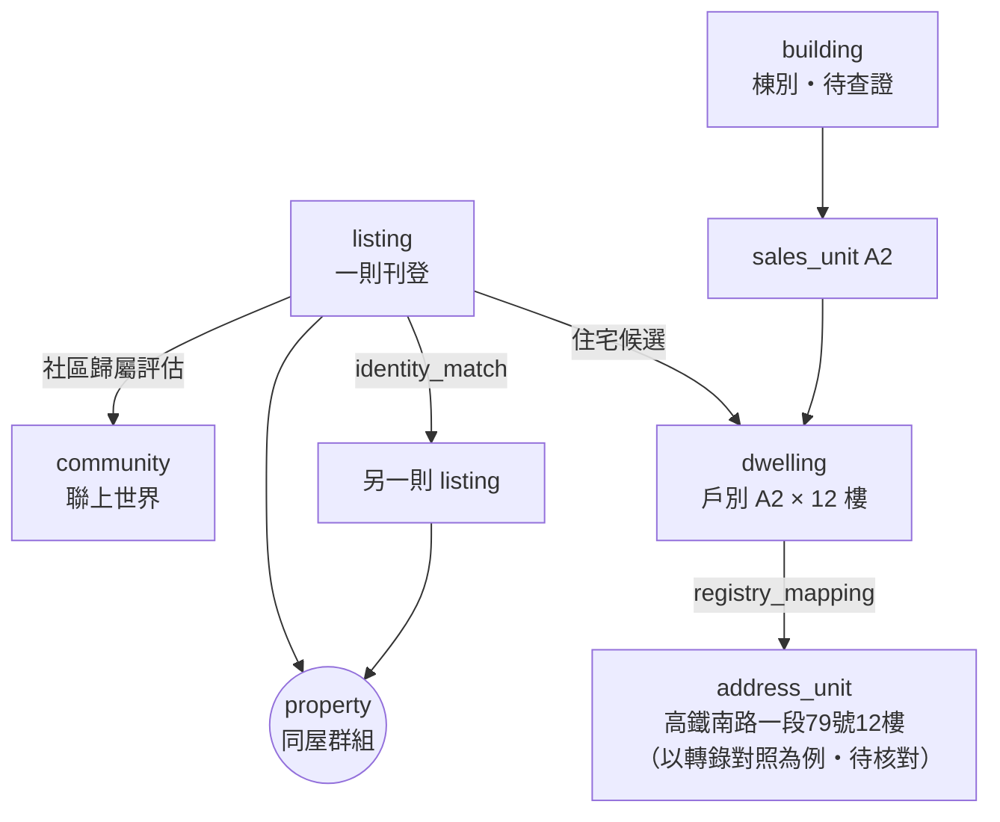

# 02 名詞與地址規則

## 1. 名詞表
| 名詞 | 識別字 | 定義 |
|------|--------|------|
| 專案代稱 | — | **JEV**。不是社區名稱（D-001） |
| 社區 | `community` | 監控目標。試點：聯上世界（`lianshang-world`，【建議預設】識別碼） |
| 棟別 | `building` | 實體建築物的標示（例如「A棟」）。與銷售戶別、門牌**分開表示** |
| 坪型 | `unit_type` | 同一種格局與面積的戶型（權狀坪、房廳衛） |
| 銷售戶別 | `sales_unit` | 建商銷售用的戶別代碼（例如 A1、D6），通常代表一個垂直戶別線；是否等於棟別【待查證】Q-017 |
| 實體住宅 | `dwelling` | 一戶可居住的實體單位：銷售戶別 × 樓層。是同屋辨識的最終對象 |
| 門牌 | `address_unit` | 戶政門牌（路段＋巷弄＋號＋之號＋樓＋之樓）。與 dwelling 的對應另存在 `registry_mapping` |
| 名冊 | registry | building、unit_type、sales_unit、dwelling、address_unit 與它們之間 mapping 的集合，有版本（`registry_version`） |
| 名冊涵蓋度 | `registry_coverage` | 名冊對某範圍（棟、戶別、樓層、路段）完整到什麼程度：COMPLETE、PARTIAL、UNKNOWN |
| 來源 | `source` | 資料出處（平台、政府資料、人工） |
| 來源文件 | `source_document` | 一次取得的頁面、圖片、表格或人工陳述，有內容雜湊；原始內容可以刪除 |
| 刊登 | `listing` | 某來源上的一則刊登，以 `(source_id, external_id)` 唯一識別 |
| 快照 | `listing_snapshot` | 刊登在某次觀測的內容（不可修改） |
| 上架週期 | `listing_cycle` | 刊登從上架到下架的一段期間；重新上架會開始新週期 |
| 同屋群組 | `property` | 系統認為指向同一間實體住宅的刊登集合；成員關係有歷史紀錄 |
| 同屋配對 | `identity_match` | 兩筆刊登「可能是同一住宅」的配對候選與判定 |
| 合併操作 | `merge_operation` | 合併、拆分、撤回的操作紀錄 |
| 證據 | `evidence` | 一則可定位的陳述：來源事實、推論或人工主張 |
| 證據關聯 | `evidence_link` | 證據支持或反駁哪個標的的哪個欄位 |
| 候選 | `candidate` | 刊登可能對應的 dwelling 或 address_unit |
| 評估 | `assessment` | 在特定規則版本、名冊版本、證據集合下，對某標的做出的判定；被新的評估取代時保留歷史 |
| 覆核任務、覆核 | `review_task`、`review` | 人工判斷的工作項目與決定；覆核可以有多次，也可以撤回 |
| 門牌推導規則 | `address_derivation_rule` | 由戶別與樓層推出完整門牌的規則，有範圍、樓層區間、例外、狀態與證據；與「涵蓋度」分開（v0.3） |
| 根來源 | `source_origin` | 證據追溯到的原始資訊出處（誰陳述、何時由誰取得）；複製、轉載、OCR、覆核引用都不會新增根來源（v0.3） |
| 來源關係 | `origin_relation` | 兩個根來源之間的關係：SAME、DEPENDENT、INDEPENDENT、UNKNOWN；UNKNOWN 不算獨立（v0.3） |
| 證據角色 | `evidence_role` | 人工佐證的角色：直接門牌、直接戶別、刊登連結、特徵觀察、其他（v0.3） |
| 規則分數 | `rule_score` | 規則加權得出的 0–1 分數，**不是機率** |
| 校準機率 | `calibrated_probability` | 只有用獨立校準集校準後才能提供；在那之前一律是 null |

## 2. 三種識別要分開

- `MEMBER`（屬於社區）不代表已經知道 dwelling；知道 dwelling 也不代表門牌對照已經查證。
- 圖中的「79號」取自【先前轉錄・待核對】的 A2=79號，而且「同一戶別各樓層共用同一個號」只是假設（Q-017）。

## 3. 樓層表示
樓層一律存成**區間**，不可以把模糊樓層轉成確定樓層。

| 原文 | `floor_min` | `floor_max` | `floor_exact` | 說明 |
|------|-------------|-------------|----------------|------|
| `12F/24F`、`12樓` | 12 | 12 | true | |
| `10~15樓` | 10 | 15 | false | |
| `中樓層` | null | null | false | 只存原文 `floor_text`；換算成區間需要該棟總樓層與分段規則（【建議預設】三等分），而且標記為推論 |
| `高樓層`、`低樓層` | 同上 | 同上 | false | 同上 |
| `頂樓` | 總樓層（若已知） | 同左 | false | 是推論，不是來源事實；也不代表頂樓的戶別與門牌安排和其他樓層相同（06 §4.1a） |
| 沒有樓層 | null | null | false | |

`floor_exact=true` 只能來自來源事實或人工主張中**明確寫出的單一樓層**。

## 4. 地址正規化（【建議預設】）
| 步驟 | 規則 | 例子 |
|------|------|------|
| N1 | 全形轉半形 | `１２樓` → `12樓` |
| N2 | 號、樓、巷、弄、段中的中文數字轉阿拉伯數字 | `一段` → `1段` |
| N3 | 樓層同義詞統一 | `12F`、`12層` → `12樓` |
| N4 | 之號統一 | `79-1號` → `79之1號` |
| N5 | 縣市、區、里、鄰拆成獨立欄位 | |
| N6 | 異體字（臺/台）只在比對鍵中統一 | |
| N7 | 去除空白與標點 | |
| N8 | 結構化：`road, section, lane, alley, number, number_sub, floor, floor_sub` | |
| N9 | 精度：`FLOOR`、`NUMBER`、`LANE`、`ROAD`、`NONE` | |

`addr_key` = `{road}|{section}|{lane}|{alley}|{number}|{number_sub}|{floor}|{floor_sub}`，例如：`高鐵南路|1|||79||12|`（號碼取自轉錄，待核對）。
