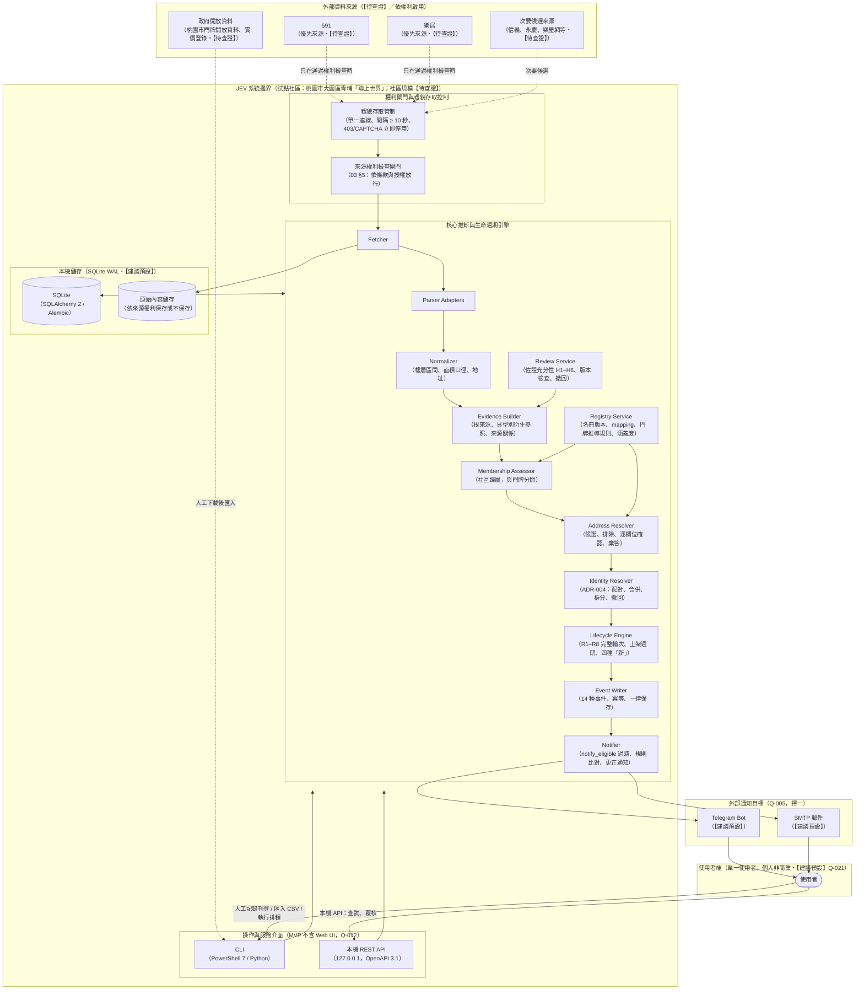
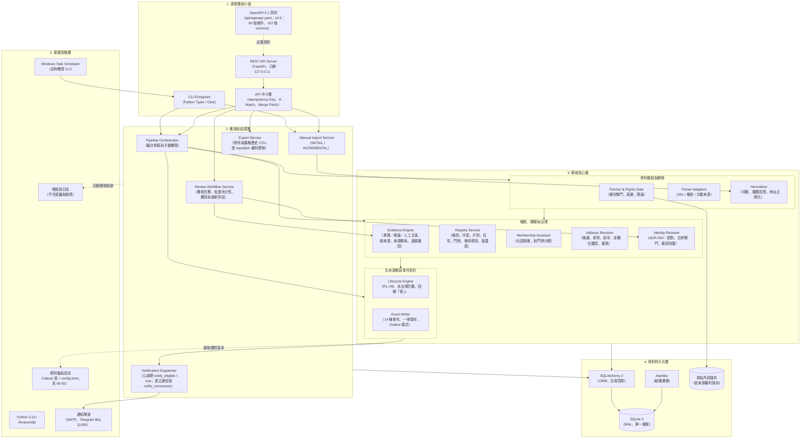
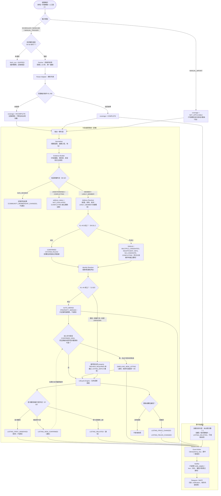
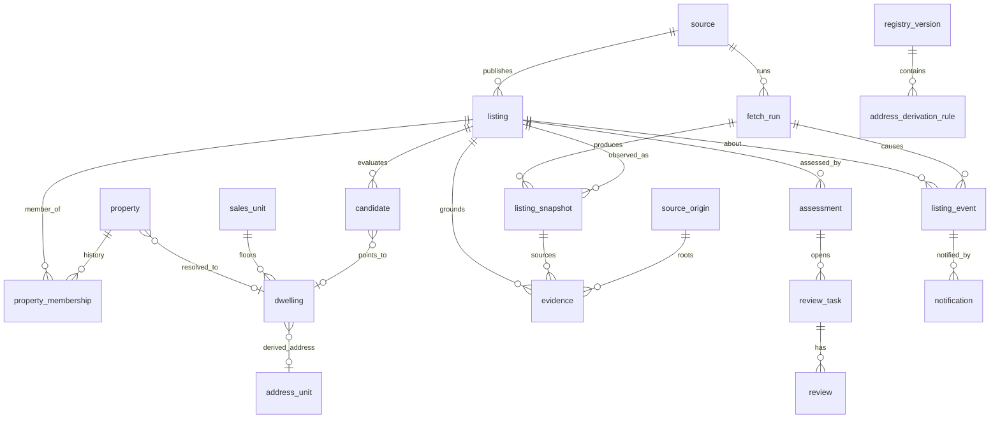

# 04 系統架構

> 本文件定義 JEV 系統的系統情境、技術分層、資料管線流程與儲存架構。
> 所有技術選型都是【建議預設】（部署與環境見 Q-006、ADR-002）。本階段**只寫規劃文件**：不實作應用、不執行爬蟲、不部署，也不聯繫外部平台（【已確認】）。
> 名稱以 [05 資料模型](05-data-model.md)、[06 門牌判定](06-address-verification.md)、[12 事件契約](12-event-contract.md) 與 [`api/openapi.yaml`](../api/openapi.yaml) 為準；本文件只畫架構，不另外定義欄位或事件。
> v0.3 修訂：保留外部改寫版的圖表版型，並把內容改成與契約一致（見 handoff）。

---

## 1. 系統情境與架構圖

說明 JEV 系統的邊界、外部資料來源、權利檢查閘門、本機操作介面、儲存系統，以及下游通知管道之間的關係。

---

## 2. 技術分層架構圖

依分層原則，定義表現層、應用協調層、領域核心層、資料持久化層與基礎設施層的技術選型與呼叫邊界（全部是【建議預設】）。

---

## 3. 資料處理與推斷管線流程圖

單一監控輪次從資料輸入、權利檢查、正規化、證據生成、社區歸屬、門牌推斷、同屋配對，到生命週期事件與通知的流程。判定細節以 06、07、12、13 為準。

---

## 4. 領域實體與儲存架構圖

只畫主要實體之間的關係；表名、欄位與型別以 [05 資料模型](05-data-model.md) 為準。

---

## 5. 元件職責與邊界

| 元件 | 職責 | 不做的事 |
|------|------|----------|
| **Fetcher** | 權利閘門（[03 §5](03-data-sources-and-compliance.md)）、單一連線限速、退避、蒐集輪次完整度資訊（R1–R8） | 不登入、不繞過 CAPTCHA、不輪換 IP、未獲授權不擷取 |
| **Parser adapters** | 每個來源一個解析器，產出快照欄位與定位資訊 | 不做業務判斷、不臆測缺漏欄位 |
| **Normalizer** | 樓層轉成區間、面積口徑換算、地址正規化（[02](02-domain-and-glossary.md)） | 不把模糊樓層（例如「低樓層」）轉成確定樓層 |
| **Evidence Builder** | 建立證據（種類、出處版本、定位、內容雜湊、根來源、具型別衍生參照）、判定來源關係（[05 §5.4](05-data-model.md)）、處理取代、過期與連鎖撤回 | 不把內容雜湊或 review_id 當成獨立來源；沒有正面佐證時不判定為獨立 |
| **Registry Service** | 名冊版本、mapping 狀態、門牌推導規則（[05 §5.5](05-data-model.md)）、涵蓋度 | 不把【先前轉錄・待核對】的資料當成已查證；不依總樓高推定樓層；不宣稱社區規模（【待查證】） |
| **Membership Assessor** | 判定刊登是否屬於試點社區（[06 §3](06-address-verification.md)） | 社區判定與門牌判定分開；名冊缺漏不等於不屬於社區 |
| **Address Resolver** | 門牌候選、排除、排序、逐欄位確認、棄答（[06 §4–5](06-address-verification.md)） | 證據不足時不給出單一確定門牌 |
| **Identity Resolver** | 跨刊登配對、依 ADR-004 判定自動合併、衝突偵測、拆分與撤回（[13](13-identity-resolution.md)） | 來源關係不是 INDEPENDENT（包括 UNKNOWN），或有衝突時不自動合併 |
| **Lifecycle Engine** | 完整輪次檢定（R1–R8）、未出現計數、上架週期、四種「新」（[07](07-monitoring-pipeline.md)） | 人工增量匯入不影響其他刊登；非 COMPLETE 輪次不累加未出現次數 |
| **Review Service** | 覆核任務、If-Match 版本檢查、佐證充分性判定（H1–H6）、把覆核轉成證據、撤回後重新評估 | 不把確認動作本身當成真值 |
| **Event Writer** | 依 [12](12-event-contract.md) 寫入 14 種事件；以 `idempotency_key` 確保冪等；事件一律保存 | 不發出契約以外的事件、不改寫歷史事件 |
| **Notifier** | 只處理 `notify_eligible = true` 的事件；比對規則、保存內容快照、重試；依 `notify_corrections` 發更正通知 | 不修改已發送的通知；合併本身不觸發新案通知 |

---

## 6. 技術選型與依據（【建議預設】）

| 項目 | 建議 | 理由 | 相關 |
|------|------|------|------|
| **語言** | Python 3.11+（Anaconda） | 使用者環境已經有；解析與資料處理生態成熟 | — |
| **API** | FastAPI + Pydantic v2 | 可以產生 OpenAPI 3.1，並和 `api/openapi.yaml` 比對 | 08 |
| **儲存** | SQLite 3（WAL） | 單機、零管理、備份就是複製檔案 | ADR-002、Q-006 |
| **ORM 與遷移** | SQLAlchemy 2 + Alembic | 日後需要時可以遷移到 PostgreSQL | ADR-002、Q-021 |
| **規則版本化** | `ruleset` 表 + `config.toml` | 相同規則版本、名冊與證據 → 相同結果（NFR-09） | 01、09 §5 |
| **排程** | Windows Task Scheduler 觸發 CLI | 不需要常駐程序 | Q-006 |
| **通知** | Telegram Bot 或 SMTP 擇一 | 個人使用門檻低 | Q-005 |
| **介面** | CLI + 本機 REST API；MVP 不做 Web UI | — | Q-012 |

---

## 7. 擴充與演進路徑（M2 以後；皆需另立需求）

1. **多社區**：資料表已保留 `community_id`；名冊版本、規則參數與統計都以社區區分。
2. **多使用者與雲端部署（Q-021、Q-006）**：加上帳號與權限機制，資料庫遷移到 PostgreSQL；部署方式另行決定。
3. **租賃（Q-020）**：`deal_type = RENT`，另外定義租金口徑（押金、管理費）與月租變動事件。
4. **Web UI（Q-012）**：MVP 不包含；如需要，於 M2 另立需求。
5. **行情比對**：實價登錄查證完成後（V-05），作為 M2 的獨立功能；估價不在本專案範圍（01 §3 非目標）。
