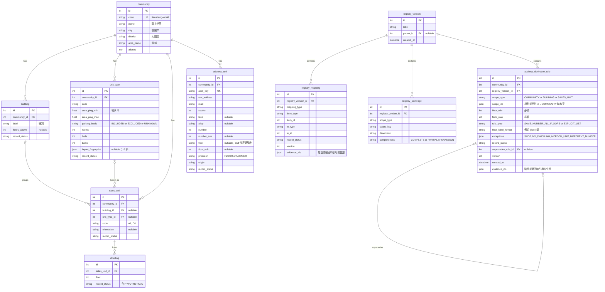
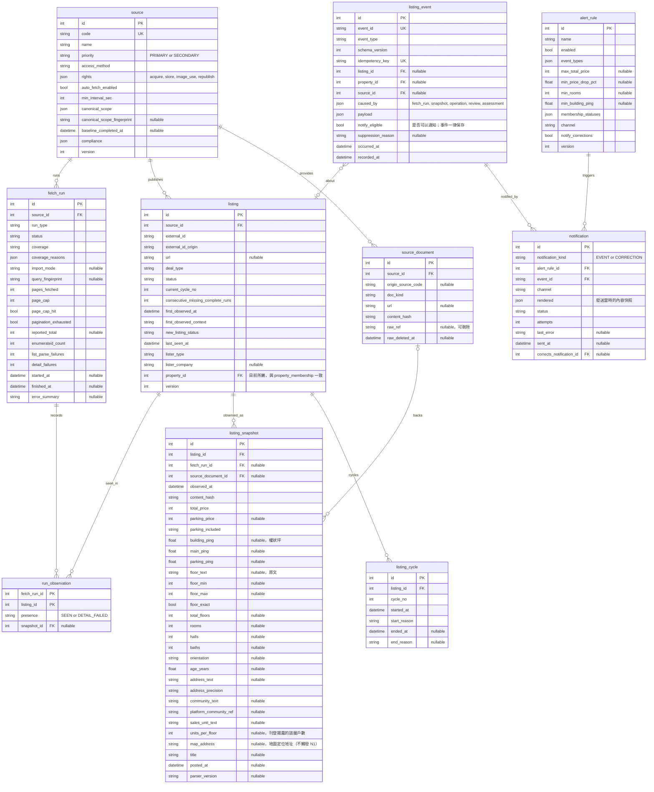
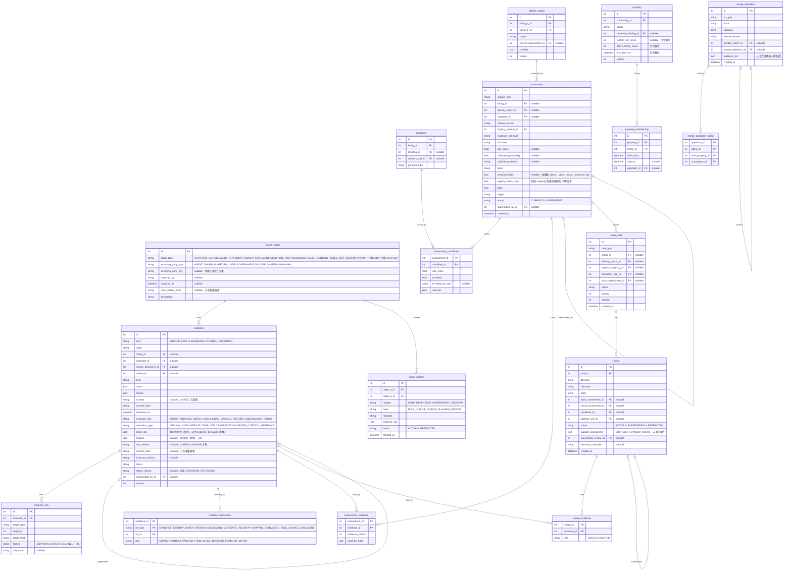

# 05 資料模型

> 【建議預設】先用 SQLite 實作，型別寫法盡量相容 PostgreSQL（ADR-002）。時間存 UTC ISO-8601；金額用整數，單位是元；面積用坪，`NUMERIC(8,2)`。`json` 欄位在 SQLite 存成 TEXT，由應用層驗證。
> 本文件是欄位名稱與 enum 的**唯一定義來源**。`api/openapi.yaml` 與 [12 事件契約](12-event-contract.md) 都要與本文件一致。

## 1. ERD（一）名冊

## 2. ERD（二）來源、刊登與監控

## 3. ERD（三）證據、評估、覆核與同屋

> 關聯修正：第一版的「每個驗證結果最多一筆 review」已改成 `review_task ||--o{ review`；覆核可以多次、可以被取代（`supersedes_review_id`），也可以撤回（`status = RETRACTED`）。

## 4. 共用 enum（與 OpenAPI 一致）
| enum | 值 |
|------|----|
| `record_status`（名冊） | `VERIFIED`、`TRANSCRIBED_UNVERIFIED`、`INFERRED`、`HYPOTHETICAL`、`CONFLICTING`、`RETRACTED` |
| `mapping_type` | `SALES_UNIT_TO_NUMBER`、`DWELLING_TO_ADDRESS`、`SALES_UNIT_TO_BUILDING`、`SALES_UNIT_TO_UNIT_TYPE` |
| `coverage.completeness` | `COMPLETE`、`PARTIAL`、`UNKNOWN` |
| `source.priority` | `PRIMARY`、`SECONDARY` |
| `access_method` | `PUBLIC_WEB`、`AUTHORIZED_API`、`AUTHORIZED_ACCOUNT`、`MANUAL_ONLY`、`NOT_ALLOWED` |
| `rights.*` | `ALLOWED`、`RESTRICTED`、`PROHIBITED`、`UNKNOWN` |
| `doc_kind` | `LISTING_PAGE`、`LISTING_LIST_PAGE`、`LISTING_PHOTO`、`FLOOR_PLAN_IMAGE`、`LAYOUT_DIAGRAM`、`SALES_CONTROL_TABLE`、`GOV_DATASET`、`TRANSACTION_RECORD`、`USER_OBSERVATION`、`PRIOR_TRANSCRIPTION` |
| `assessment.flags` | `REGISTRY_GAP`、`MAPPING_DISPUTE`、`INTERNAL_INCONSISTENCY`、`STALE_EVIDENCE`、`PHOTO_REUSE`、`AREA_BASIS_INFERRED`、`AREA_BASIS_AMBIGUOUS`、`MAP_ADDRESS_IGNORED`、`MODEL_INFERENCE_USED`（v0.6：決策模型的推論參與了計分） |
| `fetch_run.run_type` | `BASELINE`、`SCHEDULED`、`MANUAL_TRIGGER`、`MANUAL_IMPORT` |
| `fetch_run.status` | `QUEUED`、`RUNNING`、`SUCCEEDED`、`PARTIAL`、`FAILED`、`SKIPPED`、`CANCELLED` |
| `fetch_run.coverage` | `PENDING`、`COMPLETE`、`INCOMPLETE`、`NOT_APPLICABLE` |
| `coverage_reasons[]` | `RUN_NOT_SUCCEEDED`、`PAGE_CAP_HIT`、`PAGINATION_NOT_EXHAUSTED`、`LIST_PARSE_FAILURE`、`SCOPE_CHANGED`、`COUNT_MISMATCH`、`TRUNCATED_RESULT`、`SUSPICIOUS_EMPTY`、`MANUAL_IMPORT` |
| `import_mode` | `INITIAL`、`INCREMENTAL` |
| `listing.status` | `ACTIVE`、`MISSING`、`DELISTED` |
| `external_id_origin` | `PLATFORM`、`URL_HASH`、`SYSTEM_GENERATED` |
| `deal_type` | `SALE`、`RENT`（【建議預設】MVP 只用 SALE，Q-020） |
| `first_observed_context` | `BASELINE`、`INCREMENTAL`、`MANUAL_INITIAL`、`MANUAL_INCREMENTAL` |
| `new_listing_status` | `CONFIRMED_NEW`、`NOT_NEW`、`UNCONFIRMED` |
| `cycle.start_reason` | `FIRST_OBSERVED`、`RELISTED` |
| `cycle.end_reason` | `MISSING_IN_COMPLETE_RUNS`、`MARKED_SOLD`、`MARKED_REMOVED`、`MANUAL` |
| `parking_included`、`parking_basis` | `INCLUDED`、`EXCLUDED`、`UNKNOWN` |
| `address_precision` | `FLOOR`、`NUMBER`、`LANE`、`ROAD`、`NONE` |
| `evidence.kind` | `SOURCE_FACT`、`INFERENCE`、`HUMAN_ASSERTION` |
| `evidence.origin` | `LISTING_SNAPSHOT`、`SOURCE_DOCUMENT`、`PRIOR_TRANSCRIPTION`、`USER_OBSERVATION`、`REVIEW`、`RULE` |
| `evidence.status` | `ACTIVE`、`STALE`、`SUPERSEDED`、`RETRACTED` |
| `locator.type` | `JSON_PATH`、`CSS_SELECTOR`、`TEXT_SPAN`、`IMAGE_REGION`、`TABLE_CELL`、`FREE_TEXT` |
| `evidence_link.target_type` | `COMMUNITY_MEMBERSHIP`、`CANDIDATE`、`IDENTITY_MATCH`、`REGISTRY_MAPPING`、`DERIVATION_RULE` |
| `evidence_role` | `DIRECT_ADDRESS`、`DIRECT_UNIT`、`LISTING_LINKAGE`、`FEATURE_OBSERVATION`、`OTHER` |
| `derivation_type` | `ORIGINAL`、`COPY`、`REPOST`、`CROP`、`OCR`、`TRANSCRIPTION`、`REVIEW_CITATION`、`INFERENCE` |
| `derivation.ref_type` | `EVIDENCE`、`IDENTITY_MATCH`、`REVIEW`、`ASSESSMENT`、`CANDIDATE`、`REGISTRY_MAPPING`、`DERIVATION_RULE`、`SOURCE_DOCUMENT` |
| `derivation.role` | `COPIED_FROM`、`EXTRACTED_FROM`、`CITES`、`INFERRED_FROM`、`VIA_MATCH` |
| `link_method` | `AGENT_VIEWING_WITH_LISTING_REF`、`DOCUMENT_CITES_LISTING`、`INTERIOR_FEATURE_MATCH`、`OTHER` |
| `capture.method` | `PHOTO`、`DOCUMENT`、`SITE_VISIT_NOTE`、`AGENT_STATEMENT`、`SCREEN_RECORD`、`OTHER` |
| `origin_type` | `PLATFORM_LISTING`、`AGENT_STATEMENT`、`OWNER_STATEMENT`、`USER_SITE_VISIT`、`DOCUMENT`、`SALES_CONTROL_TABLE`、`GOV_RECORD`、`PRIOR_TRANSCRIPTION`、`SYSTEM` |
| `asserting_party_type` | `AGENT`、`OWNER`、`PLATFORM`、`USER`、`GOVERNMENT`、`BUILDER`、`SYSTEM`、`UNKNOWN` |
| `origin_relation.relation` | `SAME`、`DEPENDENT`、`INDEPENDENT`、`UNKNOWN` |
| `origin_relation.basis` | `RULE_I1`、`RULE_I2`、`RULE_I3`、`HUMAN_REVIEW` |
| `support_assessment.result` | `SUFFICIENT`、`INSUFFICIENT`、`NOT_APPLICABLE` |
| `derivation_rule.scope_type` | `COMMUNITY`、`BUILDING`、`SALES_UNIT` |
| `derivation_rule.rule_type` | `SAME_NUMBER_ALL_FLOORS`、`EXPLICIT_LIST` |
| `rule_exception.exception_type` | `SHOP`、`NO_DWELLING`、`MERGED_UNIT`、`DIFFERENT_NUMBER` |
| `suppression_reason` | `BASELINE_CONTEXT`、`MANUAL_INITIAL_CONTEXT`、`NOT_CONFIRMED_NEW`、`INTERNAL_EVENT` |
| `stance` | `SUPPORTS`、`REFUTES`、`NEUTRAL` |
| `candidate.generated_by` | `G1`、`G2`、`G3` |
| `assessment.subject_type` | `COMMUNITY_MEMBERSHIP`、`ADDRESS_RESOLUTION`、`LISTING_MATCH` |
| `membership_status` | `MEMBER`、`LIKELY_MEMBER`、`NON_MEMBER`、`UNDETERMINED`、`CONFLICTING` |
| `address_status` | `CONFIRMED`、`SINGLE_CANDIDATE`、`MULTIPLE_CANDIDATES`、`INSUFFICIENT_INFO`、`NO_CANDIDATE`、`CONFLICTING`、`ABSTAINED`、`NOT_EVALUATED` |
| `match_outcome` | `AUTO_MERGE_ELIGIBLE`、`REVIEW_REQUIRED`、`CANDIDATE_ONLY`、`CONFLICTING` |
| `field_status`（resolved_fields） | `CONFIRMED`、`NARROWED`、`AMBIGUOUS`、`UNKNOWN`、`CONFLICTING` |
| `basis` | `SYSTEM_RULES`、`HUMAN_REVIEW` |
| `assessment.trigger` | `NEW_SNAPSHOT`、`EVIDENCE_CHANGED`、`REGISTRY_UPDATED`、`REVIEW`、`REVIEW_RETRACTED`、`MERGE`、`SPLIT`、`REVERT`、`RULESET_UPDATED`、`MANUAL` |
| `assessment.status` | `CURRENT`、`SUPERSEDED` |
| `review_task.task_type` | `COMMUNITY_MEMBERSHIP`、`ADDRESS_CANDIDATE`、`LISTING_MATCH`、`REGISTRY_MAPPING`、`DERIVATION_RULE` |
| `review_task.status` | `OPEN`、`RESOLVED`、`OBSOLETE` |
| `review.decision` | 歸屬：`CONFIRM_MEMBER`、`CONFIRM_NON_MEMBER`；門牌：`CONFIRM_CANDIDATE`、`REJECT_CANDIDATE`、`SET_UNIT`、`MARK_INSUFFICIENT`；配對：`CONFIRM_SAME`、`REJECT_SAME`；名冊：`VERIFY_MAPPING`、`REJECT_MAPPING`、`VERIFY_RULE`、`REJECT_RULE`；通用：`ABSTAIN` |
| `review.status` | `ACTIVE`、`SUPERSEDED`、`RETRACTED` |
| `identity_match.status` | `CANDIDATE`、`AUTO_MERGED`、`CONFIRMED`、`REJECTED`、`REVERTED` |
| `merge_operation.op_type` | `AUTO_MERGE`、`MANUAL_MERGE`、`SPLIT`、`REVERT` |
| `actor` | `SYSTEM`、`USER` |
| `property.status` | `ACTIVE`、`INACTIVE` |
| `notification.status` | `PENDING`、`SENT`、`FAILED` |
| `notification_kind` | `EVENT`、`CORRECTION` |
| `channel` | `EMAIL`、`TELEGRAM`（Q-005） |

## 5. 資料字典重點
### 5.1 證據 `evidence`
| 欄位 | 說明 |
|------|------|
| `kind` | 來源事實、推論、人工主張三者分開；推論必須有衍生紀錄（`evidence_derivation`） |
| `origin` + `snapshot_id`、`source_document_id`、`review_id` | 證據出處：刊登的哪個版本、哪份文件、哪次覆核 |
| `observed_at` | 來源內容的觀測時間（不是寫入時間） |
| `field` + `value` | 陳述的欄位與值，例如 `{"field":"floor","value":{"min":12,"max":12,"exact":true}}` |
| `locator` | 內容定位，例如 `{"type":"TEXT_SPAN","value":"title[3:7]"}`、`{"type":"IMAGE_REGION","value":"plan-4of4#x=120,y=40,w=60,h=20"}` |
| `excerpt`、`excerpt_hash` | 短摘錄（≤ 200 字，已遮罩個資）與雜湊；原始內容刪除後，可以用雜湊比對 |
| `derivation_type`、`evidence_derivation` | 這筆證據是原始觀測，還是由其他實體複製、轉載、裁切、OCR、轉錄、覆核引用或推論而來。每筆衍生都以 **`(ref_type, ref_id)` 具型別參照**記錄，不使用沒有型別的整數 ID |
| `origin_ids` | 根來源集合（見 §5.4）。`ORIGINAL` 證據會建立或指向一個 `source_origin`；其他衍生方式沿用上游的根來源；`INFERENCE` 的根來源是所有上游根來源再加上 SYSTEM |
| `evidence_role`、`capture`、`link_method` | 用於人工確認（06 §5.2）：直接門牌、直接戶別、刊登連結證據的角色、取得資訊與連結方式 |
| `content_hash` | 只作為「可能重複」的線索，**不能單獨**證明兩筆證據同源或獨立 |
| ~~`dependency_group`~~ | **v0.3 移除**。舊做法（刊登者＋標題雜湊、`user:{review_id}`）會把同一張照片的兩次覆核、改標題後的轉載誤算成獨立來源 |
| `status`、`superseded_by_id` | 證據生命週期：新快照改寫同一欄位 → 舊證據 SUPERSEDED；來源被認定錯誤 → RETRACTED；超過新鮮期限 → STALE |
| `version` | 狀態每次變更都加 1；`assessment_evidence.evidence_version` 記錄評估當時用的版本 |

**新鮮期限（【建議預設】）**：價格與狀態類證據超過 14 天沒有再觀測到 → STALE；實體屬性（樓層、坪數、格局）不會因時間變成 STALE，只會因新快照而 SUPERSEDED。

### 5.2 唯一性與索引
| 表 | 約束 | 用途 |
|----|------|------|
| `listing` | UNIQUE(`source_id`, `external_id`) | 刊登身分 |
| `listing_cycle` | UNIQUE(`listing_id`, `cycle_no`) | 上架週期 |
| `address_unit` | UNIQUE(`community_id`, `addr_key`) | 門牌去重 |
| `identity_match` | UNIQUE(`listing_a_id`, `listing_b_id`)，CHECK(a < b) | 配對唯一 |
| `listing_event` | UNIQUE(`idempotency_key`)、UNIQUE(`event_id`) | 事件冪等 |
| `notification` | UNIQUE(`alert_rule_id`, `event_id`) WHERE `notification_kind = EVENT`；UNIQUE(`event_id`, `corrects_notification_id`) WHERE `notification_kind = CORRECTION` | 不重複通知；同一次更正不重複 |
| `candidate` | CHECK(`dwelling_id` 或 `address_unit_id` 至少一個不是 null) | 候選類型 |
| `property_membership` | 每個 listing 同一時間只能有一筆 `valid_to IS NULL` | 成員唯一 |
| `idempotency_record` | PK(`api_key_id`, `method`, `route`, `key`) | API 冪等（見 08 §4） |
| `evidence_derivation` | PK(`evidence_id`, `ref_type`, `ref_id`)；INDEX(`ref_type`, `ref_id`) | 由上游反查所有依賴者（連鎖撤回） |
| `origin_relation` | UNIQUE(`origin_a_id`, `origin_b_id`) WHERE status = ACTIVE，CHECK(a < b) | 來源關係唯一 |
| `address_derivation_rule` | CHECK(`floor_min` ≤ `floor_max`) | 規則樓層範圍必填 |

### 5.3 輔助表（未畫在 ERD 中）
- `idempotency_record`：`key`、`request_hash`、`response_status`、`response_body`、`created_at`、`expires_at`。
- `ruleset`：`version`、`params_json`（權重、門檻、容差）、`created_at`。
- `calibration`：`version`、`dataset_split_id`、`method`、`created_at`（M1 之後才會有）。
- **v0.6 實作新增**（`jev/db.py`；`meta.schema_version` 目前是 5，啟動時自動備份並補上新增欄位）：
  - `decision_call`：每次呼叫外部決策模型的紀錄（`purpose`、`provider`、`model`、`endpoint`、`wire_format`、`questions`、`request_hash`、`image_count`、`status`、`http_status`、`error`、`input_tokens`、`cost_usd`、`latency_ms`、`created_at`）。不存請求內容與圖片；`cost_usd` 用於每月預算上限（D-113）。
  - `lvr_transaction`：官方實價登錄中聯上世界的成交（`serial` 唯一、`season`、`number`、`floor`、`trade_date`、`rooms`、`ping_ex_parking`、`main_ping`、`total_price`、`parking_price`、`source_file`）。
  - `alert_rule.deleted_at`：刪除規則時保留紀錄（歷史通知仍然指得到規則）。
  - 模型答案存成 `evidence`（`kind = INFERENCE`、`origin = RULE`、`field` 為 `layout.front_row`、`floor.band`、`membership.text`、`identity.same`）；使用者提供的照片只存雜湊（`field = listing_photo`、`content_hash`）。
- **尚未實作**（MVP 不需要）：`building`、`registry_coverage`、`run_observation`、`source_document`；`assessment.calibrated_probability` 在 API 一律回傳 null。

### 5.4 來源相依與獨立性（v0.3，【建議預設】）
**根來源**（`source_origin`）代表一個原始資訊出處：誰陳述（`asserting_party_type`、`asserting_party_key`）、以什麼形式（`origin_type`）、何時由誰取得。

| 衍生方式 | 根來源 |
|----------|--------|
| `ORIGINAL`（第一次觀測，例如一張現場照片、一則刊登內容） | 建立新的 source_origin（必須有 `capture` 或快照出處） |
| `COPY`、`REPOST`、`CROP`、`OCR`、`TRANSCRIPTION`、`REVIEW_CITATION` | **沿用上游**的根來源，不新增 |
| `INFERENCE` | 所有上游根來源的聯集，再加上 SYSTEM |

**兩筆證據的關係** `indep(e1, e2)`，依序判定：
1. 根來源集合有交集 → `SAME`。
2. 任一方的根來源含 SYSTEM → 不視為獨立（`DEPENDENT`）。
3. 有 ACTIVE 的 `origin_relation` 是 `SAME` 或 `DEPENDENT` → 依紀錄。
4. **規則 I2**：雙方 `asserting_party_key` 相同（例如同一家仲介在不同平台刊登，即使標題不同）→ `DEPENDENT`。
5. 有 ACTIVE 的 `origin_relation = INDEPENDENT`（人工覆核，必須附理由與佐證）→ `INDEPENDENT`。
6. **規則 I3**：`content_hash` 或 `root_content_hash` 相同或高度相似 → `UNKNOWN`（只是重複線索，需要覆核才能判定）。
7. **規則 I1（需要正面佐證）**：一方是**使用者本人的原始觀測**（`origin_type = USER_SITE_VISIT`，有 `capture`，沒有任何 `derived_from`），另一方是第三方內容，而且使用者證據不是由對方衍生；取得紀錄本身就是「獨立觀測」的正面佐證 → `INDEPENDENT`。
8. 其他情況 → `UNKNOWN`。**包括兩家不同仲介**：陳述者不同，只代表「沒有已知的相依」，不是獨立的正面佐證（仲介之間常共用屋主提供的照片與資料），所以在有 `origin_relation = INDEPENDENT`（附佐證）之前維持 `UNKNOWN`（v0.3.1 修訂，D-011）。

規則：**`UNKNOWN` 一律視為不獨立**；`review_id` 只代表操作紀錄，不是來源；同一張照片被兩次覆核引用，根來源仍然只有一個。

**連鎖撤回**：任何證據、配對、覆核、名冊 mapping 或推導規則被撤回時，沿著 `evidence_derivation`（依 `ref_type`、`ref_id` 反查）找出所有直接與間接依賴的證據，標為 `RETRACTED`（`status_reason = UPSTREAM_RETRACTED`），再用 `assessment_evidence` 與 `registry_items_used` 找出所有受影響的評估並重新評估。

**不得升級**：人工主張如果只引用推論、候選清單或評估（`ref_type` 是 `ASSESSMENT`、`CANDIDATE`，或上游是 INFERENCE），根來源仍然含有 SYSTEM，不能當成決定性證據（06 §5.1 K3、§5.2 H4）。

### 5.5 門牌推導規則 `address_derivation_rule`（v0.3，【建議預設】）
| 欄位 | 說明 |
|------|------|
| `scope_type`、`scope_ids` | 適用範圍：整個社區、指定棟別，或指定戶別 |
| `floor_min`、`floor_max` | 適用的樓層區間（必填）；**不能**因為知道總樓高就自動填成 1–總樓層 |
| `rule_type` | `SAME_NUMBER_ALL_FLOORS`：門牌 =「戶別→號」+ `floor_label_format`（例如「{floor}樓」）；`EXPLICIT_LIST`：沒有通則，只能依 `DWELLING_TO_ADDRESS` 逐戶列舉 |
| `exceptions` | 陣列；每筆有 `floor_min`、`floor_max`、`sales_unit_ids`（空陣列 = 範圍內全部）、`exception_type`（`SHOP`、`NO_DWELLING`、`MERGED_UNIT`、`DIFFERENT_NUMBER`）、`override_number`（只有 DIFFERENT_NUMBER 才有）、`note` |
| `record_status` | 與名冊相同的 enum；只有 VERIFIED，而且適用於該戶別與樓層（不在例外內）的規則，才能支持系統確認（06 §4.1a） |
| `supersedes_rule_id`、`version` | 修改 = 新增一條規則取代舊規則；舊規則保留 |
| 證據 | 透過 `evidence_link(target_type = DERIVATION_RULE)` 連結；覆核任務 `DERIVATION_RULE` |

規則狀態變更 → 新的 `registry_version` → `REGISTRY_UPDATED` 事件 → 重新評估 `registry_items_used` 中含有該規則的評估，以及範圍內的戶別 × 樓層候選。

`registry_coverage` 維持只記錄**完整度**；`dimension = FLOOR` 代表「哪些樓層有住宅」這份清單的完整度，不代表推導規則正確。

## 6. 原始資料刪除與可追溯性
| 刪除後**保留** | 刪除後**無法再做到** |
|----------------|-----------------------|
| 結構化欄位（快照欄位、證據 `value`） | 用新版 parser 重新抽取原始內容 |
| 證據的 `locator`、`excerpt`（已遮罩）、`excerpt_hash`、`content_hash` | 驗證摘錄以外的原文內容 |
| `source_document` 的網址、取得時間、內容雜湊、權利快照 | 重新檢視圖片（除非權利允許保存圖片） |
| 評估、候選分數、使用的證據集合與版本 | 對已刪除內容做新的人工判讀 |
| 通知內容快照、事件 payload | — |

刪除原始內容時：`source_document.raw_ref = null`、填入 `raw_deleted_at`。依賴這份文件的證據**不改狀態**（證據值仍然有效），但 API 會回傳 `raw_available = false`。評估在相同規則與證據下仍然可以重現；**重新抽取**則無法重現。

## 7. 個資
- 不保存 `lister_name`、`lister_phone`（Q-015）；摘錄要先遮罩電話模式。
- 使用者提供的 USER_OBSERVATION（例如現場照片）只存描述與雜湊；要不要保存檔案，【待確認】。
