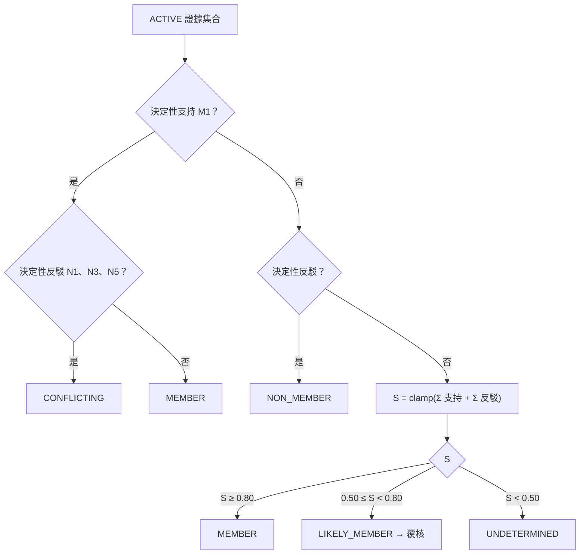
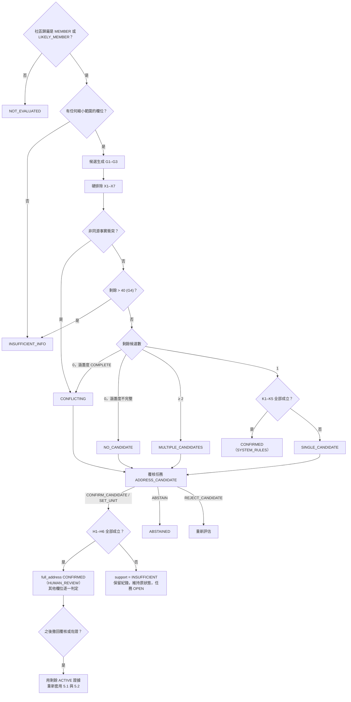

# 06 社區歸屬判定與完整門牌推斷

> 檔名沿用 `06-address-verification.md`，避免既有連結失效；內容已改成三階段判斷。
> 本文件的權重、門檻、容差都是【建議預設】，**尚未校準**（Q-010）。分數一律稱為「規則分數 `rule_score`」，不是機率（ADR-005）。

## 1. 三階段判斷與輸出
| 階段 | 標的 | 輸出 enum | 評估類型 `subject_type` |
|------|------|-----------|--------------------------|
| A. 社區歸屬 | listing → community | `membership_status`：`MEMBER`、`LIKELY_MEMBER`、`NON_MEMBER`、`UNDETERMINED`、`CONFLICTING` | `COMMUNITY_MEMBERSHIP` |
| B. 實體住宅身分＋C. 完整門牌 | listing → dwelling、address_unit | `address_status`：`CONFIRMED`、`SINGLE_CANDIDATE`、`MULTIPLE_CANDIDATES`、`INSUFFICIENT_INFO`、`NO_CANDIDATE`、`CONFLICTING`、`ABSTAINED`、`NOT_EVALUATED`；另外加上逐欄位的 `resolved_fields` | `ADDRESS_RESOLUTION` |
| 跨刊登同屋 | listing ↔ listing | 見 [13](13-identity-resolution.md) | `LISTING_MATCH` |

B 與 C 共用一份評估：候選是 dwelling（透過 `registry_mapping` 與門牌推導規則對應到門牌，§4.1a），或在名冊缺少 dwelling 時，直接是 address_unit。`resolved_fields` 可以表達「部分確認」：

| 欄位 | 狀態值 |
|------|--------|
| `building`、`sales_unit`、`floor`、`address_number`（路段＋號）、`full_address`（含樓） | `CONFIRMED`（已確認）、`NARROWED`（所有剩餘候選都一致，但還沒確認）、`AMBIGUOUS`（候選之間不一致）、`UNKNOWN`、`CONFLICTING` |

每個欄位**分開**記錄 `status`、`value`、`basis`（`SYSTEM_RULES`、`HUMAN_REVIEW` 或 null）與支持的 `evidence_ids`。`status = CONFIRMED` 時，`basis` 與 `evidence_ids` 必填（schema 強制）。某一欄位確認，不代表其他欄位也確認（§5.2）。

> 例：只知道剩下 B1、B2、B3 三戶的 12 樓 → `floor=NARROWED(12)`、`sales_unit=AMBIGUOUS`、`full_address=AMBIGUOUS`，整體是 `MULTIPLE_CANDIDATES`。

## 2. 證據與分數的通則（細節見 ADR-005 與 05 §4）
- 證據分三類：`SOURCE_FACT`（來源原文陳述）、`INFERENCE`（系統推論，必須記錄 `derived_from`）、`HUMAN_ASSERTION`（人工主張，必須附理由與佐證）。
- 證據狀態：`ACTIVE`、`STALE`、`SUPERSEDED`、`RETRACTED`；只有 `ACTIVE` 證據參與評估。
- **每條規則在一次評估中最多計分一次**（同一條規則有多個證據時，取最強的一個）。
- **獨立性**（v0.3 修訂，【建議預設】；模型見 05 §5.4）：每筆證據都追溯到它的**根來源**（`source_origin`）。複製、轉載、裁切、OCR、人工轉錄、再次覆核引用，都沿用上游的根來源，不會增加獨立來源數。兩筆證據的關係判定為 `SAME`、`DEPENDENT`、`INDEPENDENT`、`UNKNOWN`；**只有 `INDEPENDENT` 才算獨立，`UNKNOWN` 一律視為不獨立**。`review_id` 只是操作紀錄，不是來源；內容雜湊只是重複線索，不能單獨證明相同或獨立。
- **系統衍生**：根來源集合中含有 `SYSTEM`（系統推論）的證據，不能當成決定性證據；人工主張如果只是引用候選清單、S8 或其他推論，根來源仍然含有 SYSTEM，不會因為「經過人工」就升級。
- 規則分數會截在 [0, 1]；分數只用來排序與分流，**不得標示為機率**。`calibrated_probability` 在校準之前一律是 null。

## 3. 階段 A：社區歸屬
### 3.1 規則
| 規則 | 方向 | 條件（證據必須是此刊登的 ACTIVE 證據） | 效果 |
|------|------|------------------------------------------|------|
| M1 | 支持 | 刊登明寫完整門牌（精度 ≥ NUMBER），而且「路段＋號」存在於名冊；**mapping 狀態為 VERIFIED** | **決定性支持** |
| M1u | 支持 | 同 M1，但 mapping 只有 `TRANSCRIBED_UNVERIFIED` | +0.6 |
| M2 | 支持 | 平台把刊登歸在聯上世界社區頁（例如 591 社區 9488、樂居社區頁；屬於來源事實） | +0.5 |
| M3 | 支持 | 標題或社區欄位出現「聯上世界」或別名（出現在 N4 片語中的不算） | +0.2 |
| M4 | 支持 | 路段是高鐵南路一段（精度 ROAD 或 LANE） | +0.2 |
| M5 | 支持 | 總樓層等於名冊中某棟的總樓層（該棟樓層資料必須是 VERIFIED） | +0.1 |
| M6 | 支持 | 面積落在名冊某坪型的容差內（坪型必須是 VERIFIED） | +0.1 |
| N1 | 反駁 | 刊登明寫完整門牌，而且路段或行政區與社區不同 | **決定性反駁** |
| N2 | 反駁 | 社區欄位明寫其他社區名稱 | −0.5 |
| N3 | 反駁 | 總樓層超過名冊最高樓層：如果該範圍涵蓋度是 COMPLETE，屬於**決定性反駁**；否則 −0.3 | |
| N4 | 反駁 | 標題出現「近聯上世界」「聯上世界旁」等字樣 | −0.3 |
| N5 | 名冊缺口 | 同一路段、名冊裡沒有的號碼：如果該路段的地址涵蓋度是 COMPLETE，屬於**決定性反駁**；否則**不扣分**，只設 `flags += REGISTRY_GAP` | |

### 3.2 判定
1. 同時有決定性支持與決定性反駁 → `CONFLICTING`。
2. 只有決定性反駁 → `NON_MEMBER`。
3. 只有決定性支持 → `MEMBER`。
4. 其他情況，計算 S = clamp(Σ, 0, 1)：S ≥ 0.80 → `MEMBER`；0.50 ≤ S < 0.80 → `LIKELY_MEMBER`；S < 0.50 → `UNDETERMINED`。
5. **名冊裡沒有這筆紀錄，不等於不屬於社區**：除非涵蓋度是 COMPLETE，否則 N5 不會產生 `NON_MEMBER`。

## 4. 階段 B、C：候選生成、排除與排序
只有在 `membership_status` 是 `MEMBER` 或 `LIKELY_MEMBER` 時才執行；否則 `address_status = NOT_EVALUATED`。

### 4.1 候選生成
| 規則 | 內容 |
|------|------|
| G1 | 從目前的名冊版本取出全部 dwelling 作為候選 |
| G2 | 如果名冊只有「戶別→號」，沒有樓層清單（目前就是這樣：只有轉錄對照），就為每個 sales_unit 建立**假設性 dwelling**（`record_status = HYPOTHETICAL`，代表樓層存在與否尚未查證）。樓層範圍依序取：`floor_exact` 的那一層 → 來源事實的區間 → 適用於該戶別的**門牌推導規則**（§4.1a，任何非 RETRACTED 狀態）所涵蓋的樓層，並扣除例外；三者都沒有時，不生成，改判 `INSUFFICIENT_INFO`。**不得只因知道總樓高，就推定每一層都有相同的戶別與門牌安排** |
| G3 | 刊登明寫的完整門牌不在名冊時，加入一筆 **address_unit 候選**（沒有 dwelling），並設 `flags += REGISTRY_GAP` |
| G4 | **硬排除後**剩餘候選 > 40（【建議預設】）時，只記錄數量，不逐筆展開，`address_status = INSUFFICIENT_INFO` |

### 4.1a 門牌推導規則（v0.3 新增，【建議預設】；模型見 05 §5.5）
「涵蓋完整度」與「規則正確性」分開記錄：
- `registry_coverage` **只**記錄某範圍的資料完整度（COMPLETE、PARTIAL、UNKNOWN），不代表任何推導規則正確。
- `address_derivation_rule` 記錄「如何由戶別與樓層推出完整門牌」：適用範圍（社區、棟別或戶別清單）、樓層區間（`floor_min`–`floor_max`，必填）、規則類型（`SAME_NUMBER_ALL_FLOORS`：同一戶別各樓層共用同一個號，樓層寫成「N樓」；或 `EXPLICIT_LIST`：沒有通則，只能逐戶列舉）、例外（`SHOP` 店面、`NO_DWELLING` 該樓層沒有此戶、`MERGED_UNIT` 合併戶、`DIFFERENT_NUMBER` 改用其他號）、`record_status`、版本，以及證據。
- 規則可以新增、覆核（任務類型 `DERIVATION_RULE`；決定 `VERIFY_RULE`、`REJECT_RULE`）與撤回；每次狀態變更都會產生新的 `registry_version`、發出 `REGISTRY_UPDATED` 事件，並重新評估受影響的候選（範圍內的戶別 × 樓層）。

**候選門牌推導已驗證**（K2 與 X5、X7 使用）的條件——任一成立：
- (a) 該 dwelling 有 VERIFIED 的 `DWELLING_TO_ADDRESS` mapping（例如已核對的銷控表逐戶列出門牌）；或
- (b) 「戶別→號」mapping 是 VERIFIED，**而且**有一條 VERIFIED 規則適用於該戶別與樓層（樓層在區間內、不在例外內），也沒有其他非 RETRACTED 的規則對同一戶別與樓層給出不同結果。

有互相衝突的規則時：推導狀態是 CONFLICTING，設 `flags += MAPPING_DISPUTE`，K2 不成立。

> 樓層存在與否也不靠總樓高推定：只有適用規則的區間（扣除例外）或名冊中列出的 dwelling，才會讓某一層成為候選。

### 4.2 硬排除（X1–X6 只採用此刊登的 ACTIVE `SOURCE_FACT` 或 `HUMAN_ASSERTION`；X7 依據 VERIFIED 的名冊規則；推論不能硬排除）
| 規則 | 條件 | 例外 |
|------|------|------|
| X1 | `floor_exact = true`，而且樓層 ≠ 候選樓層 | — |
| X2 | 樓層區間已知（`floor_min`、`floor_max` 都不是 null），而且候選樓層不在區間內 | 「中樓層」這類原文沒有區間時不適用（見 02 §3） |
| X3 | 明寫棟別 ≠ 候選棟別 | 棟別對照不是 VERIFIED 時，改成軟反駁 −0.2 |
| X4 | 明寫銷售戶別 ≠ 候選戶別 | — |
| X5 | 明寫完整門牌（精度 FLOOR）≠ 候選的門牌 | 候選門牌推導未驗證（§4.1a）時，改成軟反駁 −0.3。如果**沒有任何**候選推導出的門牌等於明寫門牌，設 `flags += MAPPING_DISPUTE`（名冊可能有誤） |
| X6 | 權狀坪（車位口徑已知而且一致）超出坪型範圍 ±1.0 坪 | 坪型不是 VERIFIED，或車位口徑不明時，改成軟反駁 −0.1 |
| X7 | 候選的戶別與樓層落在**VERIFIED 規則**的 `SHOP` 或 `NO_DWELLING` 例外內（此為名冊事實） | 規則不是 VERIFIED 時，改成軟反駁 −0.3 |

被排除的候選保留在評估中（`excluded = true`，附 `excluded_by` 規則與證據），以供追溯。

### 4.3 軟計分（每個剩餘候選從 0 開始，最後截在 [0, 1]）
| 規則 | 條件 | 分數 |
|------|------|------|
| S1 | 明寫完整門牌 = 候選門牌 | +0.6 |
| S2 | 明寫銷售戶別 = 候選戶別 | +0.4 |
| S3 | 權狀坪與坪型區間的距離（落在區間內時為 0）≤ 0.3 坪：+0.15；介於 0.3 與 1.0 坪之間：+0.05 | |
| S4 | 房廳衛與坪型一致：+0.1；不一致：−0.2（可能改過格局，所以只算軟反駁） | |
| S5 | 朝向一致：+0.1；不一致：−0.2 | |
| S6 | 刊登附的平面圖經人工標註為該坪型（HUMAN_ASSERTION） | +0.2 |
| S7 | `floor_exact` 與候選樓層一致 | +0.1 |
| S8 | **繼承**：同屋群組中另一則刊登的 S1 或 S2 證據，產生 INFERENCE（`derived_from` 指向原證據與 identity_match），分數減半；**永遠不是決定性證據** | ×0.5 |

### 4.4 衝突
同一欄位（樓層、戶別、門牌）有兩筆 ACTIVE 事實，值不相容：
- 兩者來源關係是 `SAME`（例如同一快照的標題與樓層欄位）→ 視為抽取或刊登錯誤：採用欄位值，設 `flags += INTERNAL_INCONSISTENCY`，不算 CONFLICTING。
- 其他關係（`DEPENDENT`、`INDEPENDENT`、`UNKNOWN`）→ `address_status = CONFLICTING`，兩邊的候選都保留，送覆核。衝突判定採保守做法：不確定是否同源時，仍視為衝突。

## 5. 完整門牌的判定規則
| 狀態 | 條件 |
|------|------|
| `NOT_EVALUATED` | 社區歸屬不是 MEMBER 或 LIKELY_MEMBER |
| `CONFLICTING` | 有 §4.4 的衝突；或名冊涵蓋度為 COMPLETE，但所有候選都被排除 |
| `INSUFFICIENT_INFO` | 刊登沒有任何能縮小範圍的欄位（沒有樓層、面積、戶別、門牌），或命中 G4 |
| `NO_CANDIDATE` | 所有候選都被排除，而且相關範圍的名冊涵蓋度**不是** COMPLETE（`reason = REGISTRY_INCOMPLETE`）；**這不影響社區歸屬** |
| `MULTIPLE_CANDIDATES` | 剩餘候選 ≥ 2 |
| `SINGLE_CANDIDATE` | 剩餘候選恰好 1 個，但不符合確認條件 |
| `CONFIRMED` | `full_address` 欄位是 CONFIRMED：由 §5.1 的系統條件，或 §5.2 的人工條件達成 |
| `ABSTAINED` | 人工棄答；或評估所需的關鍵證據全部變成 STALE 或 RETRACTED，還在等待新證據 |

### 5.1 系統確認（`basis = SYSTEM_RULES`）——全部都要成立
- K1 剩餘候選恰好 1 個。
- K2 該候選的**門牌推導已驗證**（§4.1a 的 (a) 或 (b)）；`TRANSCRIBED_UNVERIFIED` 的 mapping 或規則都不符合。
- K3 有決定性事實，而且來自**此刊登自己的**證據（衍生鏈中不含 identity_match，也就是不能是 S8 繼承），根來源也不含 SYSTEM：S1；或 S2 加上 `floor_exact`；或兩筆來源關係為 `INDEPENDENT` 的事實共同把候選縮到 1 個，而且其中有 `floor_exact`（`UNKNOWN` 不算獨立）。
- K4 沒有 ACTIVE 的反駁證據指向該候選，也沒有衝突。
- K5 用到的證據全部是 ACTIVE。

### 5.2 人工確認完整門牌（`basis = HUMAN_REVIEW`，v0.3 修訂，【建議預設】）
人工可以依**獨立、可追溯，而且足以唯一識別此刊登住宅的直接證據**確認 `full_address`，**不必**連帶宣稱戶別或棟別的 mapping 已經驗證。覆核決定 `SET_UNIT` 或 `CONFIRM_CANDIDATE` 送出後，系統用下列條件判定佐證是否充分（結果寫在 `review.support_assessment`）：

| 條件 | 內容 |
|------|------|
| H1 直接門牌證據 | 至少一筆 ACTIVE 證據，`evidence_role = DIRECT_ADDRESS`，內容是精度 FLOOR 的完整門牌；屬於原始觀測（`derivation_type` 是 `ORIGINAL`、`TRANSCRIPTION` 或 `OCR`，而且上游也是原始觀測），例如現場門牌照片、仲介書面提供的門牌 |
| H2 刊登連結證據 | 至少一筆 ACTIVE 證據，`evidence_role = LISTING_LINKAGE`，說明**如何證明門牌所指的住宅就是此刊登物件**。`link_method` 必須是：`AGENT_VIEWING_WITH_LISTING_REF`（由此刊登的刊登者帶看，並記錄刊登編號）、`DOCUMENT_CITES_LISTING`（同一份文件同時載明刊登編號與門牌）、`INTERIOR_FEATURE_MATCH`（現場照片與刊登照片的獨特特徵逐項比對，並列出特徵）。`OTHER` **不符合**（只會留下紀錄） |
| H3 可追溯 | H1、H2 的證據都有取得資訊（取得者、時間、方式）以及內容雜湊或定位 |
| H4 非系統衍生 | H1、H2 的根來源都不含 SYSTEM；不能只是引用候選清單、S8 或其他推論 |
| H5 唯一 | H1 的門牌對應到唯一一個 address_unit（或 G3 的新門牌），而且與此刊登的樓層事實（X1、X2）相容 |
| H6 無未解決反駁 | 沒有 ACTIVE 的反駁證據；有的話 → `CONFLICTING`，送覆核 |

說明：
- H1 與 H2 可以來自同一份文件（例如一份同時寫刊登編號與門牌的書面資料），但必須各自有定位。
- **以下情況不充分**：只在覆核中填地址文字；只有照片描述，沒有刊登連結；只按下確認。這些情況會保留覆核與證據紀錄（`support_assessment.result = INSUFFICIENT`，並列出未達成的條件），但評估結果維持原本依規則得出的候選狀態，任務保持 OPEN。
- 「有人提供門牌照片」本身不充分：照片只能滿足 H1；還需要 H2 證明照片中的住宅就是此刊登物件。

**逐欄位的結果**（人工確認只確認有直接證據的欄位）：

| 欄位 | H1–H6 成立時 | 說明 |
|------|--------------|------|
| `full_address`、`address_number` | CONFIRMED（HUMAN_REVIEW） | — |
| `floor` | CONFIRMED（HUMAN_REVIEW） | 樓層是完整門牌的一部分 |
| `sales_unit` | 只有在有 `DIRECT_UNIT` 證據並滿足 H2–H4，或該門牌對應的推導已驗證（§4.1a）時，才是 CONFIRMED；否則依候選邏輯維持 NARROWED、AMBIGUOUS 或 UNKNOWN | 不因門牌確認而宣稱戶別 mapping 已驗證 |
| `building` | 同 `sales_unit` 的原則 | — |

### 5.3 撤回與重新評估
撤回覆核或任何佐證（包括上游證據被撤回，見 05 §5.4 的連鎖撤回）之後，系統用**剩餘的 ACTIVE 證據**重新套用 §5.1 與 §5.2：
- 還有其他充分的佐證（另一組 H1–H6 成立）→ 維持 CONFIRMED，`evidence_ids` 改成剩下的佐證。
- 沒有充分佐證 → 結果由規則重新推出（例如 SINGLE_CANDIDATE 或 MULTIPLE_CANDIDATES），**不會固定降回某個狀態**。

> 目前名冊只有轉錄對照（全部是 TRANSCRIBED_UNVERIFIED），也沒有已驗證的推導規則，所以**在 V-01 與推導規則核對完成之前，`SYSTEM_RULES` 不會產生 `CONFIRMED`**。`HUMAN_REVIEW` 則可以在 §5.2 條件成立時確認完整門牌，但不會因此把戶別或棟別標成 CONFIRMED。

## 6. 評估的版本、取代與重新評估
- 每一次評估都記錄：`ruleset_version`、`registry_version`、使用的證據集合（`assessment_evidence`，含證據版本）、候選分數，以及觸發原因 `trigger`。
- 觸發重新評估：新快照、證據狀態變更、名冊版本更新、覆核決定或撤回、合併／拆分／撤回合併、規則版本更新（手動批次）。
- 新評估產生後，舊評估改成 `SUPERSEDED`，並記錄 `superseded_by_id`；結果有變化時，發出 `ADDRESS_ASSESSMENT_CHANGED` 或 `COMMUNITY_MEMBERSHIP_CHANGED` 事件。
- 給定相同的規則版本、名冊版本、證據集合（證據值保存在 DB），評估結果是**決定性的**，可以重現。

## 7. 覆核分流
| 任務類型 `task_type` | 進入條件 |
|----------------------|----------|
| `COMMUNITY_MEMBERSHIP` | LIKELY_MEMBER、CONFLICTING |
| `ADDRESS_CANDIDATE` | SINGLE_CANDIDATE、CONFLICTING、NO_CANDIDATE；MULTIPLE_CANDIDATES 在候選 ≤ 5，或最高分候選領先第二名 ≥ 0.30 時（【建議預設】） |
| `LISTING_MATCH` | 同屋配對候選（見 13） |
| `REGISTRY_MAPPING` | mapping 是 TRANSCRIBED_UNVERIFIED 或 CONFLICTING |
| `DERIVATION_RULE` | 門牌推導規則不是 VERIFIED、規則之間有衝突，或例外有爭議 |

覆核規則：
- 一個任務可以有多次覆核。最新一筆 ACTIVE 覆核生效，舊覆核改成 SUPERSEDED；覆核也可以撤回（RETRACTED），撤回後重新評估。
- 覆核送出時必須帶上任務版本（`If-Match`）。任務所依據的評估已經被取代時，回應 412，避免過期的覆核覆蓋較新的結果（見 08）。
- 覆核量【建議目標】每週 ≤ 30 筆（Q-023）。

## 8. 名冊與涵蓋度
- 名冊依 [source-log §4](project/source-log-lianshang-world.md#4-資料準備順序已確認順序細節是建議預設) 的順序建立；**不預設使用者提供完整 CSV**。
- `registry_coverage` 依範圍記錄完整度（例如「高鐵南路一段 77–109 號單號：PARTIAL」）。目前所有範圍都是 `UNKNOWN` 或 `PARTIAL`，所以 N5 與「全部排除」都不會導出 NON_MEMBER。
- 涵蓋度**不**代表推導規則正確；規則正確性只看 `address_derivation_rule.record_status`（§4.1a）。
- 名冊每次更新都會產生新的 `registry_version`，並觸發受影響刊登的重新評估。
