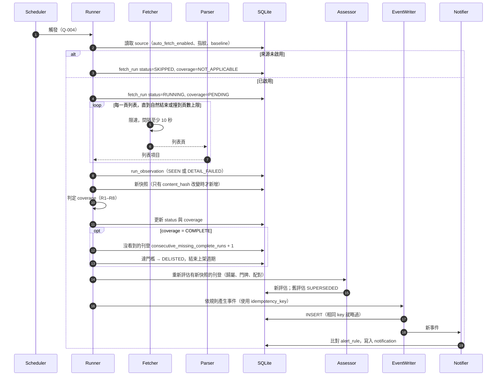
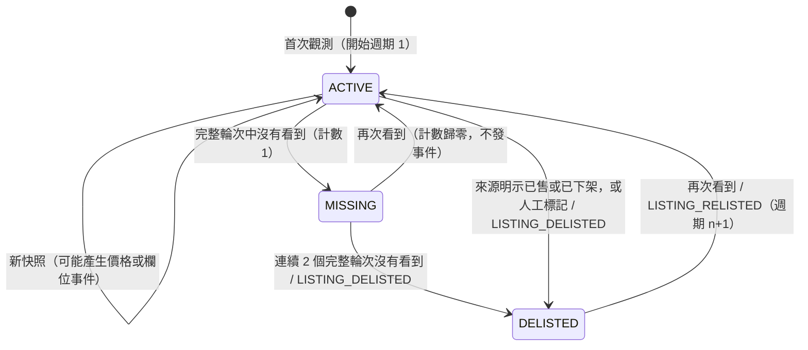

# 07 監控生命週期

> 自動擷取只適用於通過 03 §5 檢查的來源；本階段沒有任何來源啟用。人工匯入走同樣的下游流程。
> 欄位與 enum 依照 [05](05-data-model.md)；事件依照 [12](12-event-contract.md)。

## 1. 四種「新」要分開
| 概念 | 事件 | 何時發生 | 預設通知（【建議預設】） |
|------|------|----------|----------------------------|
| 系統首次觀測 | `LISTING_FIRST_OBSERVED` | 系統第一次看到某個 `(source, external_id)`，一律發出 | 不通知 |
| 確認新刊登 | `LISTING_NEW_CONFIRMED` | 首次觀測，而且符合 §3 的「新刊登確認條件」 | 通知 |
| 系統發現新的同屋關係 | `PROPERTY_MERGED` | 自動或人工合併（包括初始化資料之間、延遲完成的合併） | **不通知**（只保存） |
| 同一住宅真正新增刊登 | `DWELLING_NEW_LISTING` | 加入群組的刊登本身是 `CONFIRMED_NEW`（不是 BASELINE、MANUAL_INITIAL），**而且**群組中有比它更早首次觀測的其他刊登；兩個條件都成立的那一刻發出 | 通知 |
| 原刊登重新上架 | `LISTING_RELISTED` | 已 `DELISTED` 的同一個 `(source, external_id)` 再次被看到 | 通知 |

v0.3 修正（【建議預設】）：第一版只要「併入既有 property」就發 DWELLING_NEW_LISTING，會讓初始化時的重複刊登在稍後合併時被當成新案通知。現在改成：
- 是否屬於初始化資料，記錄在刊登的 `first_observed_context` 與 `new_listing_status`，並帶入事件 payload；**不看合併發生的時間**。
- 事件一律保存；是否通知由 `notify_eligible` 決定（12 §2.1）。
- 冪等鍵是 `dwelling_new_listing:{listing_id}`，每則刊登最多一次；不使用 `operation_id`，也不依賴可變的群組 anchor。拆分後再合併，只發更正通知，不重發新案（12 §3、§5）。

## 2. 輪次與完整度
### 2.1 輪次類型
| `run_type` | 說明 | `coverage` |
|------------|------|------------|
| `BASELINE` | 第一次完整盤點來源範圍；第一個 COMPLETE 的 BASELINE 完成後，填入 `source.baseline_completed_at` | 依 §2.2 判定 |
| `SCHEDULED` | 排程輪次 | 依 §2.2 判定 |
| `MANUAL_TRIGGER` | 手動觸發的完整輪次 | 依 §2.2 判定 |
| `MANUAL_IMPORT` | 人工單筆或 CSV 匯入（`import_mode = INITIAL / INCREMENTAL`） | 固定為 `NOT_APPLICABLE` |

### 2.2 完整輪次（`coverage = COMPLETE`）的條件——全部成立
| # | 條件 | 不成立時的 `coverage_reasons` |
|---|------|-------------------------------|
| R1 | `status = SUCCEEDED` | `RUN_NOT_SUCCEEDED`（包括 PARTIAL、FAILED、CANCELLED） |
| R2 | 分頁自然結束（沒有下一頁），`pagination_exhausted = true` | `PAGINATION_NOT_EXHAUSTED` |
| R3 | 沒有撞到頁數上限（`page_cap_hit = false`） | `PAGE_CAP_HIT` |
| R4 | `query_fingerprint = source.canonical_scope_fingerprint`（篩選條件沒有改變） | `SCOPE_CHANGED` |
| R5 | 列表頁解析失敗數 = 0 | `LIST_PARSE_FAILURE` |
| R6 | 如果平台有提供總數：`enumerated_count = reported_total` | `COUNT_MISMATCH` |
| R7 | 沒有截斷訊號（例如「僅顯示前 N 筆」） | `TRUNCATED_RESULT` |
| R8 | 不是異常空結果：前一個完整輪次 > 0 筆，這輪卻是 0 筆，視為異常 | `SUSPICIOUS_EMPTY` |

- `PARTIAL` 狀態：有部分頁面在重試後仍然失敗；**一定是 INCOMPLETE**。
- 詳情頁失敗（`presence = DETAIL_FAILED`）不影響「有出現」的判定，但這輪不會為該刊登產生快照。
- 篩選範圍變更（R4）時：記錄新指紋，需要重新做 BASELINE，在那之前所有輪次都是 INCOMPLETE。

### 2.3 未出現次數
- **只有 `coverage = COMPLETE` 的輪次**，才會讓「沒被看到的 ACTIVE 或 MISSING 刊登」的 `consecutive_missing_complete_runs` 加 1。
- INCOMPLETE 與 NOT_APPLICABLE 的輪次：不加、不歸零。
- 被看到（任何輪次，包括 INCOMPLETE 與人工匯入中的同一則刊登）→ 歸零。
- **人工增量匯入**只影響它自己匯入的刊登，不會讓其他刊登增加未出現次數，也不會讓它們下架。
- `SRC-MANUAL` 的刊登沒有完整輪次，所以只能透過 `:mark-delisted` 或來源明示（已售、已下架）下架。

## 3. 新刊登確認條件（`LISTING_NEW_CONFIRMED`）
| 情境 | 條件 | `first_observed_context` | `new_listing_status` |
|------|------|--------------------------|----------------------|
| 初始化（BASELINE 期間，或 `baseline_completed_at` 為 null） | — | `BASELINE` | `NOT_NEW`（不發 NEW_CONFIRMED） |
| 排程輪次首次觀測 | 這輪 COMPLETE，**而且**前一輪同指紋的完整輪次沒有這則刊登；如果平台有刊登日 `posted_at`，必須 ≥ `baseline_completed_at` | `INCREMENTAL` | `CONFIRMED_NEW` |
| 排程輪次首次觀測，但條件不完整 | 這輪 INCOMPLETE，或前一輪不是 COMPLETE，或 `posted_at` 早於 baseline | `INCREMENTAL` | `UNCONFIRMED`；之後如果符合條件，**最多補發一次** NEW_CONFIRMED |
| 人工初始化匯入（`import_mode = INITIAL`） | — | `MANUAL_INITIAL` | `NOT_NEW` |
| 人工增量匯入 | 該列標記 `is_new_listing = true`，或 `posted_at` ≥ 監控開始日 | `MANUAL_INCREMENTAL` | `CONFIRMED_NEW`，否則 `UNCONFIRMED` |

> **初始化匯入舊房源時，不會當成新案通知**：它們只會產生 `LISTING_FIRST_OBSERVED`（context = BASELINE 或 MANUAL_INITIAL）。

## 4. 一輪自動擷取的循序圖

## 5. 刊登狀態與上架週期

- 下架門檻：【建議預設】連續 2 個完整輪次（`lifecycle.delist_after_missing_complete_runs`）。
- **下架事件不需要新快照**：payload 帶 `last_snapshot_id`、`cycle_no`、`reason`、`missing_complete_run_ids`。
- 下架與重新上架可以重複多次：每個週期有自己的 `cycle_no`，事件冪等鍵含 `cycle_no`（12 §3）。

## 6. 價格與欄位事件
| 事件 | 條件 |
|------|------|
| `LISTING_PRICE_CHANGED` | 新快照的 `total_price` 不同於同一週期上一筆快照；payload 帶 `direction = DOWN / UP`。跨週期（重新上架）的價差放在 RELISTED 的 payload |
| `LISTING_FIELDS_CHANGED` | 坪數、樓層、格局、地址文字改變；同時觸發重新評估 |

property 的價格彙總（`current_min_price`）在每次合併、拆分或撤回之後都要重新計算（13 §7）。

## 7. 錯誤處理
| 狀況 | 行為 |
|------|------|
| HTTP 429 或 503 | 遵守 `Retry-After`；沒有的話依序等 30、60、120 秒，最多重試 3 次；失敗就是 PARTIAL 或 FAILED |
| HTTP 403、CAPTCHA、要求登入 | 立即中止，`status = FAILED`；自動把 `auto_fetch_enabled` 設為 false，並告警；**不嘗試繞過** |
| 列表解析失敗 | `LIST_PARSE_FAILURE` → INCOMPLETE；同一來源連續 3 輪 → 告警，並暫停自動擷取 |
| 連續 3 輪 FAILED | `/health` 顯示 `degraded`；發出 `SOURCE_HEALTH_CHANGED` 事件 |
