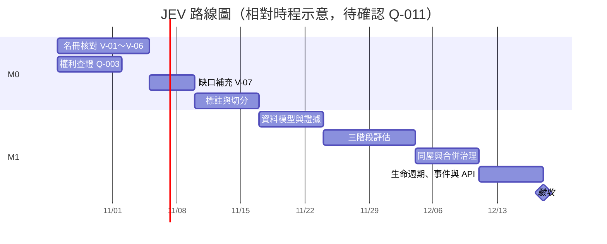

# 11 里程碑與風險

## 1. 里程碑（【建議預設】；時程與預算見 Q-011）
| 里程碑 | 內容 | 出口條件 |
|--------|------|----------|
| M0 查證與名冊 | V-01～V-07（source-log §5）；591、樂居的權利查證（Q-003）；建立名冊第一版與涵蓋度；建立標註集並切分 | 00 中所有 P0 都有結論；名冊版本凍結；評估集凍結 |
| M1 MVP | 人工記錄、正規化、證據、三階段評估、覆核、同屋候選、拆分、撤回、重新評估、生命週期、事件、通知、本機 API | AC-01～AC-16 通過；評估報告依 10 §6 產出（數值以實測為準） |
| M1.5 自動來源 | 對權利檢查通過的來源實作 parser 與排程 | 連續 7 天沒有被封鎖；完整輪次比例另外報告 |
| M2 擴充 | Web UI、行情比對（實價登錄）、多社區、租賃（依 Q-020） | 另立需求 |

（日期只是相對排程的示意，不是承諾。）

## 2. 風險登錄
| ID | 風險 | 可能性 | 影響 | 對策 |
|----|------|--------|------|------|
| RK-01 | 平台條款限制自動化或保存 | 【待查證】 | 高 | 人工記錄與授權介面優先（ADR-003）；依權利保存 |
| RK-02 | 平台改版導致 parser 失效 | 高 | 中 | parser 版本化、fixture、失敗時把輪次標成 INCOMPLETE |
| RK-03 | 刊登不揭露門牌，門牌覆蓋率低 | 高（Q-018） | 高 | 多候選、部分確認、覆核；覆蓋率與正確率分開報告 |
| RK-04 | 轉錄對照有誤 | 中 | 高 | 核對前不作為 CONFIRMED 依據（06 K2） |
| RK-05 | 名冊不完整，被誤判為不屬於社區 | 中 | 中 | 涵蓋度機制（N5） |
| RK-06 | 同樓不同戶被誤合併 | 中 | 高 | ADR-004；拆分、撤回、重新評估 |
| RK-07 | 誤報新案（舊刊登被當成新刊登） | 中 | 中 | baseline 與完整輪次條件（07 §3） |
| RK-08 | 覆核量太大 | 中 | 中 | 分流門檻；Q-023 |
| RK-09 | 規則分數被誤讀成機率 | 中 | 中 | 欄位命名與 UI 文案；校準前 `calibrated_probability = null` |
| RK-10 | 個資與著作權疑慮 | 低–中 | 高 | 03、09 |
