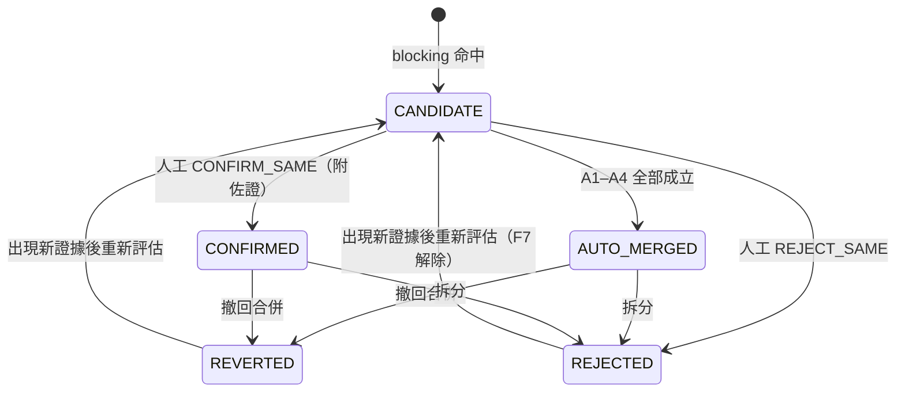

# 13 同屋辨識與合併治理

> 原則【已確認】（D-008）：相似特徵只會產生**配對候選**；證據不足時不自動合併。MVP 就要提供撤回合併、拆分與重新評估。
> 權重與門檻是【建議預設】，尚未校準。

## 1. 物件模型
- `property`（同屋群組）：系統認為指向同一間實體住宅的刊登集合。每則刊登任何時刻最多屬於一個 property。
- `property_membership`：成員關係的歷史紀錄（`valid_from`、`valid_to`、`operation_id`），**不覆寫**。
- `identity_match`：兩則刊登的配對（`listing_a_id < listing_b_id`），有自己的評估（`subject_type = LISTING_MATCH`）與狀態。
- `merge_operation`：所有合併、拆分、撤回動作的紀錄（操作者、理由、規則版本、受影響刊登、前後 property）。

每則刊登在第一次觀測時，會先放進只有它自己的 property（singleton）。

## 2. 配對候選生成（Blocking）
兩則刊登同時符合下列條件時，建立 `identity_match(status = CANDIDATE)`：
- 兩者的社區歸屬都是 `MEMBER` 或 `LIKELY_MEMBER`；
- 兩者的門牌評估剩餘候選有**交集**，或者（兩者都是 INSUFFICIENT_INFO 時）權狀坪差距 ≤ 1.0 坪，而且樓層區間有交集；
- 兩者在時間上有重疊，或前一則下架後 180 天內出現另一則（【建議預設】）。

## 3. 配對規則分數（排序與分流用，不是機率）
| 規則 | 條件 | 分數 |
|------|------|------|
| P1 | 兩者門牌評估的剩餘候選交集恰好 1 個 | +0.4 |
| P2 | 權狀坪差距 ≤ 0.1 坪 | +0.2；介於 0.1 與 0.5 坪之間：+0.1 |
| P3 | 兩者都是 `floor_exact`，而且相同 | +0.2 |
| P4 | 房廳衛相同 | +0.1 |
| P5 | 朝向相同 | +0.1 |
| P6 | 刊登照片或描述的特徵經人工標註為相同（HUMAN_ASSERTION） | +0.3 |
| P7 | 兩者的刊登內容來源關係是 `SAME` 或 `DEPENDENT`（例如同一刊登者跨平台轉載，即使改了標題；見 05 §5.4 的 I2） | +0.2；這條只能提高配對分數，**不能**單獨滿足自動合併條件 |

## 4. 衝突條件（任何一條成立 → 不得自動合併；配對標記 `conflicts[]`）
| 代號 | 條件 |
|------|------|
| F1 | 兩者都是 `floor_exact`，而且樓層不同 |
| F2 | 車位口徑相同，但權狀坪差距 > 0.5 坪 |
| F3 | 房數不同 |
| F4 | 朝向不同 |
| F5 | 明寫的銷售戶別或門牌不同 |
| F6 | 其中一方的門牌評估是 CONFLICTING |
| F7 | 這兩則刊登先前曾被拆開或判定 REJECTED，而且之後沒有新證據（證據的建立時間晚於該操作） |

## 5. 自動合併的必要條件（全部成立，ADR-004）
- A1 兩者的社區歸屬都是 `MEMBER`（不是 `LIKELY_MEMBER`）。
- A2 兩者的門牌評估都是 `CONFIRMED`，指向同一個 dwelling；而且兩邊決定性事實的來源關係是 **`INDEPENDENT`**（05 §5.4）。`SAME`、`DEPENDENT`、`UNKNOWN` 都不成立；衍生鏈中含有對方證據或 identity_match（S8 繼承）的事實也不算。（v0.3：取代第一版以 dependency_group 判斷的做法）
- A3 沒有任何 F1–F7 衝突。
- A4 合併後的群組中，每一對成員也都不違反 F1–F5。

其他情況：配對分數 ≥ 0.50 → 建立 `LISTING_MATCH` 覆核任務；< 0.50 → 只保留候選，不打擾使用者。

配對評估（`subject_type = LISTING_MATCH`）的 `outcome`：

| outcome | 條件 | 後續 |
|---------|------|------|
| `AUTO_MERGE_ELIGIBLE` | A1–A4 全部成立 | 系統自動合併（`op_type = AUTO_MERGE`） |
| `CONFLICTING` | 命中任一 F1–F7 | 不合併；分數 ≥ 0.50 時建立覆核任務 |
| `REVIEW_REQUIRED` | 沒有衝突、不符合自動合併，而且分數 ≥ 0.50 | 建立 `LISTING_MATCH` 覆核任務 |
| `CANDIDATE_ONLY` | 沒有衝突，而且分數 < 0.50 | 只保留候選 |

> **同樓不同戶**：B1、B2、B3 的 12 樓，坪型相同、房數相同時，P2、P3、P4 都會加分，但 P1 不成立（交集有 3 個），A2 也不成立 → 只會建立配對候選或覆核任務，**不會自動合併**。

## 6. 人工合併與確認
- `CONFIRM_SAME` 或 `POST /properties:merge`：必須附理由與 ≥ 1 筆佐證，並產生 HUMAN_ASSERTION 證據。
- `REJECT_SAME`：記錄理由；之後要有新證據才會再建立任務（F7）。
- 人工確認同屋，**不會**讓兩邊的門牌評估自動互相變成 CONFIRMED（見 §8）。
- 合併（自動或人工）一律發出 `PROPERTY_MERGED`（保存、不通知）。只有群組中有「真正新增」的刊登（`CONFIRMED_NEW`，而且群組中有更早首次觀測的其他刊登）時，才對該刊登發出 `DWELLING_NEW_LISTING`（12 §2.1）。初始化資料（BASELINE、MANUAL_INITIAL）之間的合併不會通知。

## 7. 拆分、撤回與重新評估（MVP 就要提供）
| 操作 | API | 效果 |
|------|-----|------|
| 拆分 | `POST /properties/{id}:split` | 把成員分成兩組以上；被分開的成員之間的配對改成 `REJECTED`（`reason = SPLIT`）；建立新的 property |
| 撤回合併 | `POST /merge-operations/{id}:revert` | 把受影響刊登的成員關係還原到該操作之前；配對改成 `REVERTED`。如果之後的操作依賴它，回應 409，並列出要先撤回的操作 |
| 重新評估 | `POST /assessments:reassess` | 依指定範圍重新計算歸屬、門牌、配對評估 |

拆分或撤回之後，系統必須依序執行：
1. 沿著 `evidence_derivation` 找出所有直接或間接依賴該配對（`ref_type = IDENTITY_MATCH`）的證據（S8 繼承、P 規則衍生，以及引用它們的人工主張），改成 `RETRACTED`（`status_reason = UPSTREAM_RETRACTED`）。
2. 重新評估受影響刊登的門牌（`trigger = SPLIT` 或 `REVERT`）。
3. 重新計算 property 的衍生欄位：`current_min_price`、`active_listing_count`、`status`、`first_seen_at`、`resolved_dwelling_id`。
4. 發出 `PROPERTY_SPLIT` 或 `MERGE_REVERTED` 事件，以及評估變更事件。
5. **歷史通知不修改**：通知保存發送當時的事件 ID 與內容快照；如果 alert_rule 的 `notify_corrections = true`（【建議預設】），就另外發一則更正通知，引用原本的事件 ID。
6. 之後不論合併回同一個群組，或改併到其他群組：`DWELLING_NEW_LISTING` 的冪等鍵是 `dwelling_new_listing:{listing_id}`（每則刊登最多一次），不會重複產生事件與新案通知；只會再發一則 `PROPERTY_MERGED`（不通知），必要時再發一則引用原通知的更正通知（`notification_kind = CORRECTION`）。

## 8. 門牌確認的傳播限制
- 人工確認刊登 L1 的門牌時，**只**作用在 L1。
- 同一群組的 L2 只會得到 S8 繼承證據（INFERENCE，分數減半，`derived_from` 包含 L1 的證據與 `IDENTITY_MATCH`）。S8 不符合 K3；它的根來源含 SYSTEM，也不符合人工確認的 H1、H2、H4（06 §5.2）。所以 L2 **不會**只因繼承而變成 CONFIRMED；L2 要確認，必須有連結到 L2 自己的直接證據。
- identity_match 被撤回或拆分時，S8 證據隨之 RETRACTED，L2 重新評估。

## 9. 配對狀態


## 10. 操作紀錄範例
```json
{
  "id": 42,
  "op_type": "SPLIT",
  "actor": "USER",
  "rationale": "B2 與 B3 同為 12 樓、坪型相同，但照片中的陽台方向不同",
  "evidence_ids": [901],
  "ruleset_version": "match-rules@0.2.0",
  "identity_match_id": 33,
  "affected": [
    {"listing_id": 11, "from_property_id": 5, "to_property_id": 5},
    {"listing_id": 17, "from_property_id": 5, "to_property_id": 8}
  ],
  "reverts_operation_id": null,
  "created_at": "2026-11-02T03:00:00Z"
}
```
