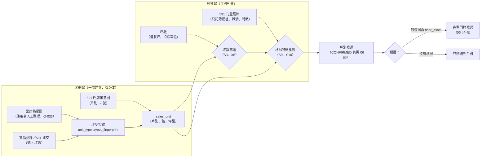

# 16 坪型指紋與刊登照片比對（戶別辨識）

> v0.5 新增。目標調整【已確認】（D-016）：用 **591 刊登照片** 辨識戶別，並用**坪數**對照；以**樂居格局圖**（逐戶別）連結 **591 門牌示意圖**，得到「戶別 → 號」。
> 比對分兩階段並列規劃【已確認】：階段 1 人工比對，階段 2 自動影像辨識。具體規則、欄位與門檻都是【建議預設】。
> 本文件只處理「辨識戶別」。樓層與完整門牌仍依 06（照片通常無法判斷樓層）。

## 1. 整體流程

## 2. 坪型指紋（`unit_type.layout_fingerprint`）
每個坪型（以及它對應的戶別）記錄一組可以比對的特徵。來源與狀態都要記錄；樂居格局圖在人工整理並核對前，是 `TRANSCRIBED_UNVERIFIED`。

| 特徵 | 例子 | 用途 |
|------|------|------|
| `area_ping_ex_parking`（權狀坪，扣除車位） | 30.0、36.1 | 第一層篩選 |
| `main_ping`（主建物）、`balcony_ping` | 20.73、1.22 | 輔助篩選（信義刊登常揭露） |
| `rooms` / `halls` / `baths` | 2/2/1 | 篩選；可能改過格局，只能軟反駁 |
| `mirror` | `L`、`R`（同坪型的左右鏡像） | **區分坪數相同的戶別** |
| `block_position` | 棟內位置：`TL`、`TR`、`ML`、`MR`、`BL`、`BR`（T = 靠高鐵南路的前排） | 前排或後排可以從窗景判斷；例如 D2（TR）與 D5（BR）是上下鏡像 |
| `mirror_pair` | 互為鏡像的戶別清單，例如 D2 ↔ D5 | 告訴比對者「要看哪一個特徵」（[樂居格局分析](research/leju-layout-analysis.md)） |
| `kitchen_type`、`kitchen_position` | 開放式、靠窗 | 照片比對 |
| `bathroom_window` | 有／無對外窗 | 照片比對 |
| `balcony_count`、`balcony_position` | 前陽台、後陽台 | 照片比對 |
| `living_window_orientation` | 東南 | 照片與刊登朝向比對；依樂居指北針推論的立面方位（上 ≈ 西北、右 ≈ 東北、下 ≈ 東南、左 ≈ 西南），刊登的「落地窗朝向」可以指出棟內排別（軟計分） |
| `corner_unit` | 是／否 | 照片（雙面採光）、刊登「邊間」 |
| `distinctive_features` | 弧形外牆、L 型客廳、凸窗 | 照片比對（最有區分力） |
| `view_hints` | 可見高鐵站、面中庭 | 照片比對；可附加樓層區間的粗估（只能當區間） |

## 3. 規則（併入 06 §4.3，【建議預設】）
| 規則 | 條件 | 效果 |
|------|------|------|
| S3（強化） | 權狀坪（扣除車位）與坪型的距離 ≤ 0.3 坪 → +0.15；0.3 到 1.0 坪 → +0.05。坪型是 VERIFIED 而且車位口徑已知時，超過 1.0 坪 → X6 硬排除 | 坪數是第一層篩選 |
| S9 | 照片格局特徵與候選戶別的指紋吻合：每個吻合的**區分性特徵**（`mirror`、`distinctive_features`、`kitchen_position`、`corner_unit`）+0.1，上限 +0.3 | 軟加分 |
| S10 | 照片格局特徵與候選戶別的指紋明確衝突（例如鏡像方向相反） | −0.3（軟反駁，**不硬排除**） |
| S11 | 照片的窗景線索 → 樓層區間 | 只產生 INFERENCE 的樓層區間（`floor_exact = false`）；**不能**當成 X1、X2 的硬排除依據 |

**坪數口徑歧義（雙口徑試算，【建議預設】）**：刊登沒有明說面積是否含車位時，系統同時用「含車位（扣除車位坪數）」與「不含車位」兩種口徑計算 S3：
- 只有一種口徑命中坪型（距離 ≤ 1.0 坪）→ 採用該口徑，設 `flags += AREA_BASIS_INFERRED`，S3 加分減半。
- 兩種都命中 → 兩組候選都保留，設 `flags += AREA_BASIS_AMBIGUOUS`。
- 都沒有命中 → 不加分，也不排除（坪型可能還沒有登錄）。
- 例：591 S20981775（37.775 坪、車位 7.807 坪）→ 只有含車位口徑命中 C3（29.968 ≈ 30.0）。見 [房源抽樣 L6](research/listing-sample-analysis.md)。

**為什麼照片不能硬排除，也不能確認門牌**：
- 仲介可能沿用同坪型其他戶，甚至其他社區的照片；照片也可能是裝潢前或格局變更前拍的。
- 照片可以分辨戶別（坪型與鏡像），但通常無法分辨**樓層**。
- 因此照片比對的結果是 `FEATURE_OBSERVATION`（人工）或 `INFERENCE`（模型），**不是** 06 §5.2 的 `DIRECT_ADDRESS`，也不能單獨滿足 H1。

**照片重複使用的偵測**：同一張照片（內容雜湊相同或高度相似）出現在不同刊登時，依 05 §5.4 的 I3 視為 `UNKNOWN`，並在兩則刊登加上 `flags += PHOTO_REUSE`；兩則刊登的照片證據不算獨立；有 `PHOTO_REUSE` 的照片，**S9、S10 都不計分**（避免沿用的照片誤導戶別判斷）。

## 4. 階段 1：人工比對（MVP）
1. 刊登的坪數 → 系統列出候選戶別（S3、X6）。
2. 系統顯示候選戶別的格局指紋與格局圖（樂居來源，依權利決定只顯示連結或人工轉錄的特徵）。
3. 人工依「比對清單」逐項勾選照片中看到的特徵：每項都要記錄照片網址、照片序號、看到的內容。
4. 系統依 S9、S10 計分，輸出戶別候選與排序；人工可以送出 `CONFIRM_CANDIDATE`，但依 06 §5.2，這只會讓 `sales_unit` 有人工依據，**完整門牌**仍需要直接門牌證據與樓層。

人工比對產生的證據：`kind = HUMAN_ASSERTION`、`evidence_role = FEATURE_OBSERVATION`、`derivation_type = REVIEW_CITATION`（引用照片的 source_document），根來源沿用該刊登的根來源（照片屬於刊登內容），**不會**因為人工比對而變成獨立來源。

## 5. 階段 2：自動影像辨識（規劃，尚未實作）
| 項目 | 規劃（【建議預設】） |
|------|----------------------|
| 介面 | 模型輸入照片特徵（不保存原圖時，只能在暫存中處理後丟棄），輸出每個候選戶別的特徵吻合清單與 `model_score`；寫成 `kind = INFERENCE` 的證據，`derived_from` 指向照片的 source_document，`extractor_version` 記錄模型版本 |
| 分數 | `model_score` 是模型分數，**不是機率**；校準前不得顯示為機率（ADR-005） |
| 權重上限 | 模型證據最多等同 S9 的 +0.3；不能硬排除、不能確認 |
| 啟用條件 | (1) 階段 1 已累積足夠的人工標註（【建議目標】≥ 200 則照片組，依實體住宅分組切分，10 §6）；(2) 在獨立評估集上，戶別辨識的精確率、覆蓋率、棄答率分開報告，並由使用者核准；(3) 照片的使用權利允許這種處理（Q-034） |
| 退場條件 | 模型與人工結果的分歧率超過門檻、平台條款改變，或照片權利不允許 |
| 成本 | 見 14（模型推論、標註人力） |

## 6. 權利與保存
- 591 刊登照片：只供瀏覽。**不保存照片**；只保存照片網址、序號、內容雜湊、人工轉錄的特徵（03 §2 的 UNKNOWN 保守處理）。不批次下載；階段 2 的處理方式要等 Q-034 決定。
- 樂居格局圖：樂居對自動化請求回 403（2026-10-18 兩次）。改由**使用者人工瀏覽並整理**（Q-033），整理時記錄來源網址、頁面定位、觀測時間；格局圖本身不放進 repo，除非樂居的條款允許。
- 591 門牌示意圖：同 M0，只記錄定位與轉錄結果。
- **AI 增強或重新生成的圖片**（超解析、重繪、去浮水印等）**不能當成來源事實**：生成工具可能捏造標示與文字。如果用來輔助閱讀，只能登錄為 `INFERENCE`（根來源含 SYSTEM），而且結論必須回到原圖確認。要看清楚原圖，請用瀏覽器放大原始頁面後截圖。

## 6a. 辨識矩陣：坪數 + 樓層 + 照片的分工（【建議預設】）
辨識順序：**坪數 → 戶別群組**；**樓層 → 第幾層**（刊登揭露時）；**照片 → 鏡像配對中的哪一戶**。三者合起來，再加上推導規則，得到完整門牌。

| 坪數群組（推論） | 戶別 | 坪數 + 樓層就夠？ | 照片要判斷的 | 照片線索（依樂居平面圖推論） |
|------------------|------|-------------------|--------------|------------------------------|
| 約 30 坪 | C3 | 夠 | 只檢查有沒有衝突 | — |
| 約 33.6 坪 | D3 | 夠 | 只檢查有沒有衝突 | — |
| 約 41 坪 | C5 | 夠 | 只檢查有沒有衝突 | — |
| 約 32 坪 | D1、D6 | 不夠 | **前段或後段**（上下鏡像） | 窗景朝向；與梯廳、C 棟的相對位置 |
| 約 36 坪 | D2、D5 | 不夠 | **前段或後段**（上下鏡像） | 同上；刊登「落地窗東北」只能確認在右欄，不能區分兩戶 |
| 約 43.7 坪 | C1、C2 | 不夠 | **左右鏡像** | 站在客廳面向窗戶時，廚房與衛浴在左側或右側 |
| 約 48–49 坪 | B1、B2、B5、B3 | 不夠 | **前後排＋左右鏡像**（兩項都要） | 窗景能否看到高鐵南路（前排）；廚衛在左側或右側 |
| 約 64／71 坪 | A 棟 | 待補 A1、A2 坪數 | 視坪數補齊後而定 | 前後排；右側戶有外牆凸出（雨遮或陽台） |

**第一次實測（591 S20790495，D2／D5）**：坪數＋樓層縮小到 2 個門牌候選；照片中的「廚房在入口右側」與「客廳窗外緊鄰另一棟」兩個線索指向不同戶別，因為兩者都依賴低解析平面圖 → 記為無法判斷。結論：照片比對需要**清晰的逐戶平面圖**（廚衛與窗戶的確切位置），以及**各立面面對哪一棟或哪個方向**的配置資料；社區公設照片沒有區分力（見 [房源抽樣 L7](research/listing-sample-analysis.md)）。

照片判斷的規則：
- 照片依 S9、S10 加減分；只有當鏡像特徵**清楚可見**（例如同一張照片同時拍到客廳窗與廚房）時，才記錄為吻合或衝突。看不清楚就記「無法判斷」，不加減分。
- 平台照片很少左右翻轉，但仍然可能發生；如果照片中有文字（例如插座標示、對講機面板上的字）呈現反向，就把這張照片的鏡像判斷記為「無法判斷」，不計分。
- 照片分辨出戶別之後，**完整門牌**仍然只是候選；要確認，需要 06 §5.2 的直接門牌證據。

## 7. 用 M0 數據試算（推論，只供說明）
| 刊登坪數（扣除車位） | 候選戶別（依 591 成交第 1 頁的參考坪數） | 照片要區分的重點 |
|----------------------|------------------------------------------|------------------|
| 30.0 | C3（97 號） | 只有一個候選；照片只用來檢查有沒有衝突 |
| 32.0–32.1 | D1（101 號）、D6（109 號） | 鏡像方向、邊間 |
| 36.1 | D2（103 號）、D5（107 號） | 鏡像方向、窗位 |
| 43.6–43.9 | C1（93 號）、C2（95 號） | 鏡像方向 |
| 48.4–49.0 | B2、B3、B5（87、89、91 號） | 前排或後排、窗景 |
| 64.0 | A5（83 號）；A1、A2、B1 坪數未知，無法排除 | 需要先補齊 A1、A2、B1 的坪數 |

> 坪數參考值只來自 20 筆成交，都是推論。樂居格局圖整理完成、並與官方實價登錄核對後，才能把坪型提升為 VERIFIED。
