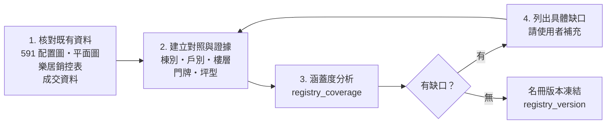

# 聯上世界來源紀錄

> 本檔記錄來源入口、先前人工閱圖的線索，以及 **2026-10-18 M0 唯讀查證**的結果（授權見 D-015）。完整結果見 [M0 可行性報告](../research/m0-feasibility-report.md)。

## 1. 來源入口與 M0 查證結果（2026-10-18 17:21–17:28 +08:00）
| 代號 | 入口 | 用途 | 優先 | M0 結果 |
|------|------|------|------|---------|
| SRC-591-COMMUNITY | https://market.591.com.tw/9488 | 社區資訊、出售與成交入口 | 高 | **可讀**。社區名「聯上世界」，地址高鐵南路一段 77 號（代表地址），217 戶，屋齡 10 年；出售列表 `/9488/sale`（18 筆），成交列表 `/9488/price?trans_type=1`（333 筆，只讀了第 1 頁 20 筆）。概況頁 `/9488/overview`：4 棟、215 戶住家 + 2 戶店面、地上 14／地下 3、建商「聯上開發」、地址寫 107 號（與社區頁不一致） |
| SRC-591-ALBUM | https://market.591.com.tw/9488/album?childType=plan&type=all | 平面圖 | 高 | **可讀**。平面圖 4 張：01 B3F 車位、02／03 2F 平面圖（文件翻拍）、04 591 自製戶別→號示意圖 |
| SRC-LEJU-COMMUNITY | https://www.leju.com.tw/community/L14e993880c0d2 | 銷控表、成交、門牌篩選 | 高 | **無法存取（HTTP 403，含 robots.txt）**；沒有繞過。內容全部未查證 |
| SRC-BUILDER | https://www.5v.com.tw/projects.php | 建商資料 | 中 | **無法連線（DNS 查無紀錄）**。591 與信義都標示建商為「聯上開發」；5v.com.tw 與該建商的關係只來自搜尋結果（Q-022） |
| GOV-TY-ADDR | https://opendata.tycg.gov.tw/datalist/ec47dbd5-9ed8-4c8d-8ce1-ccb63b1b72e6 | 門牌名冊 | 高 | **可讀**。「桃園市門牌位置坐標資料」，民政局，每月 CSV，政府資料開放授權條款第 1 版；欄位有號、巷、弄，**沒有樓層**；沒有下載（全市檔案） |
| GOV-LVR | https://plvr.land.moi.gov.tw/DownloadOpenData | 成交資料 | 中 | **可讀**。開放資料批次檔（本期、非本期），開放授權需註明出處；沒有下載（Q-031） |
| SRC-SINYI（M0 新增，次要） | https://www.sinyi.com.tw/communitylist/communityinfo/0026219 | 社區、成交、刊登 | 次要 | **可讀**。聯上世界、77 號、建商聯上開發、14 層、**216 戶**；條款禁止自動擷取 |

**注意**：「樂居」（leju.com.tw）和「樂屋網」是不同的平台。樂居是優先來源；樂屋網只是次要候選。

## 2. 先前人工閱圖轉錄（M0：**原圖已核對**，沒有獨立佐證）
> **M0 結果**：2026-10-18 17:22 讀取 591 相簿平面圖第 4 張（alt「聯上世界-平面圖04」），17 組對照**全部一致**。該圖是 591 自製的示意圖，不是建商原始文件。沒有找到獨立佐證，所以 `record_status` 維持 `TRANSCRIBED_UNVERIFIED`（備註「原圖已核對」），**不升級成 VERIFIED**。逐筆紀錄見 [lianshang-world-address-mapping.csv](../research/lianshang-world-address-mapping.csv)。
>
> M0 也回答了部分推論：A–D 對應 4 棟（591 概況頁、591 問答，同一來源）；2F 平面圖顯示 2F 只有 11 戶（A1、A2、B1、B2、C1、C2 不存在）；沒有 A4 等戶別（591 示意圖與 2F 平面圖都沒有）。

- 來源：先前人工閱讀 591 相簿「平面圖4/4」所做的紀錄。
- 內容：高鐵南路一段的戶別與門牌號對照。

| 戶別 | 門牌號 | 戶別 | 門牌號 | 戶別 | 門牌號 | 戶別 | 門牌號 |
|------|--------|------|--------|------|--------|------|--------|
| A1 | 77號 | B1 | 85號 | C1 | 93號 | D1 | 101號 |
| A2 | 79號 | B2 | 87號 | C2 | 95號 | D2 | 103號 |
| A3 | 81號 | B3 | 89號 | C3 | 97號 | D3 | 105號 |
| A5 | 83號 | B5 | 91號 | C5 | 99號 | D5 | 107號 |
| | | | | | | D6 | 109號 |

共 17 筆。路名：高鐵南路一段（同樣是轉錄內容）。

### 2.1 使用限制
- **不是完整的逐戶名冊**：只有「戶別→號」，沒有樓層、之號、坪型、朝向。
- 以下解讀都是**未經核對的推論**，不得當成事實：
  - 「A–D」是棟別還是銷售分區？（Q-017）
  - 同一戶別是否各樓層共用同一個號，只用「N 樓」區分？（Q-017）
  - 沒有 A4、B4、C4、D4，可能是避開數字 4，也可能是轉錄遺漏。
  - D6 只出現在 D 區，原因不明。
  - 是否有店面、其他路段的門牌、「之號」？
- 匯入資料模型時：每筆對照都存成 `registry_mapping`，`status = TRANSCRIBED_UNVERIFIED`，證據 `kind = SOURCE_FACT`、`origin = PRIOR_TRANSCRIPTION`；**在獨立核對前，不能作為 `CONFIRMED` 門牌判定的依據**（見 06 §5）。

## 3. 樂居銷控表
- 已知：樂居社區頁有銷控表入口（使用者提供）。
- M0：社區頁對自動化請求回應 403，**沒有看到銷控表**，也沒有嘗試繞過。2026-10-18 17:46 第二次唯讀查詢仍然 403；搜尋引擎也找不到這個社區 ID 的格局圖頁面（搜尋結果中的「聯上世界極」是高雄楠梓的預售案，**不是**本社區）。
- **2026-10-18 使用者瀏覽器截圖（2 張，18:53、18:55）**，檔案只在使用者本機，沒有放進 repo（圖上有「樂居科技 Copyright」標示）：
  - **樂居門牌示意圖**：17 組戶別→號與 591 示意圖完全一致。**版型與 591 幾乎相同**（格子排列、梯間位置、指北針），依 05 §5.4 的 I3 視為「疑似同源」，來源關係 `UNKNOWN`，**不算獨立佐證**。
  - **樂居平面圖「…9.11.13F平面圖」**：可見 4 個區塊（3 × 4 戶 + 1 × 5 戶 = 17 戶）。直接觀察：至少 9F、11F、13F 有 17 戶。標題前段被截斷，不能推定其他樓層。圈內戶別編號因解析度太低無法辨識；區塊與 A–D 棟的對應屬於推論（5 戶區塊 = D 棟）；一戶以黃色標示，無法確認是哪一戶。
- v0.5（D-016）：改由使用者用瀏覽器人工整理格局圖與坪數，格式見 [`leju-layout-intake-template.csv`](../research/leju-layout-intake-template.csv)（Q-033）。
- 未知：完整內容、欄位（戶別、樓層、坪數、成交與否）、是否需要登入、可不可以保存（【待查證】）。
- 預期用途：建立「戶別 × 樓層」的住宅清單，以及坪型對照。

## 4. 資料準備順序【已確認順序；細節是建議預設】

- **不預設使用者要自行提供完整 CSV**。CSV 匯入只是補充缺口的管道之一。
- 每一個核對動作都要留下證據紀錄（來源、版本、觀測時間、內容定位）。

## 5. 核對工作清單（M0，2026-10-18 執行）
| # | 工作 | 狀態 | 結果 |
|---|------|------|------|
| V-01 | 重新閱讀 591「平面圖4/4」，核對 17 筆對照 | **完成（原圖已核對）** | 17／17 一致；沒有獨立佐證 → 維持 TRANSCRIBED_UNVERIFIED |
| V-02 | 核對 591 其他配置圖：棟別、戶別位置、朝向 | **部分完成** | 2F 平面圖：2F 有 11 戶、2 間辦公室；朝向未知；3F–14F 沒有平面圖 |
| V-03 | 檢視樂居銷控表 | **受阻** | HTTP 403；待使用者人工確認 |
| V-04 | 查證桃園門牌開放資料 | **部分完成** | 欄位、授權、更新頻率已確認；沒有樓層；沒有下載資料比對號碼範圍（Q-031） |
| V-05 | 查證實價登錄欄位與揭露程度 | **部分完成** | 開放資料與授權已確認；欄位依同格式資料集；門牌完整揭露規定來自地方 QA 與新聞，官方原文待核對；591 成交第 1 頁 20 筆已讀 |
| V-06 | 查證建商網站 | **受阻** | DNS 無法解析；建商名稱「聯上開發」來自 591 與信義 |
| V-07 | 彙整缺口清單 | **完成** | M0 報告 §7–8 |
