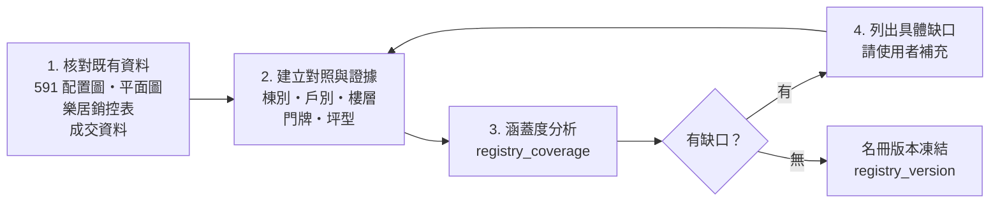

# 聯上世界來源紀錄

> 本檔記錄使用者提供的來源入口，以及先前人工閱圖得到的線索。**本專案在本階段沒有連線查證任何網址。** 以下網址的內容、可用性與條款都是【待查證】。

## 1. 來源入口（使用者提供，2026-10-18）
| 代號 | 入口 | 用途（預期） | 優先 | 狀態 |
|------|------|--------------|------|------|
| SRC-591-COMMUNITY | https://market.591.com.tw/9488 | 591 社區頁：社區資訊、出售刊登入口 | 高 | 【待查證】內容、條款、出售列表網址 |
| SRC-591-ALBUM | https://market.591.com.tw/9488/album?childType=plan&type=all | 591 社區相簿：平面圖、配置圖 | 高 | 【待查證】；包含先前閱圖來源「平面圖4/4」 |
| SRC-LEJU-COMMUNITY | https://www.leju.com.tw/community/L14e993880c0d2 | 樂居社區頁；有**銷控表入口**，也可能有成交資料 | 高 | 【待查證】銷控表的完整內容尚未核對 |
| SRC-BUILDER | https://www.5v.com.tw/projects.php | 建商作品頁：建案資料、配置 | 中 | 【待查證】建商名稱，以及是否列有聯上世界（Q-022） |
| GOV-TY-ADDR | https://opendata.tycg.gov.tw/datalist/ec47dbd5-9ed8-4c8d-8ce1-ccb63b1b72e6 | 桃園市門牌開放資料 | 高 | 【待查證】資料集欄位、授權條款、更新日期、是否含樓層 |
| GOV-LVR | 內政部實價登錄（入口待補） | 成交資料：用於名冊核對、價格參考 | 中 | 【待查證】揭露程度要依資料版本與欄位逐一查證 |

**注意**：「樂居」（leju.com.tw）和「樂屋網」是不同的平台。樂居是優先來源；樂屋網只是次要候選。

## 2. 先前人工閱圖轉錄【先前轉錄・待核對】
- 來源：先前人工閱讀 591 相簿「平面圖4/4」所做的紀錄（不是本次查證）。
- 內容：高鐵南路一段的戶別與門牌號對照。

| 戶別 | 門牌號 | 戶別 | 門牌號 | 戶別 | 門牌號 | 戶別 | 門牌號 |
|------|--------|------|--------|------|--------|------|--------|
| A1 | 77號 | B1 | 85號 | C1 | 93號 | D1 | 101號 |
| A2 | 79號 | B2 | 87號 | C2 | 95號 | D2 | 103號 |
| A3 | 81號 | B3 | 89號 | C3 | 97號 | D3 | 105號 |
| A5 | 83號 | B5 | 91號 | C5 | 99號 | D5 | 107號 |
| | | | | | | D6 | 109號 |

共 17 筆。路名：高鐵南路一段（同樣是轉錄內容）。

### 2.1 使用限制
- **不是完整的逐戶名冊**：只有「戶別→號」，沒有樓層、之號、坪型、朝向。
- 以下解讀都是**未經核對的推論**，不得當成事實：
  - 「A–D」是棟別還是銷售分區？（Q-017）
  - 同一戶別是否各樓層共用同一個號，只用「N 樓」區分？（Q-017）
  - 沒有 A4、B4、C4、D4，可能是避開數字 4，也可能是轉錄遺漏。
  - D6 只出現在 D 區，原因不明。
  - 是否有店面、其他路段的門牌、「之號」？
- 匯入資料模型時：每筆對照都存成 `registry_mapping`，`status = TRANSCRIBED_UNVERIFIED`，證據 `kind = SOURCE_FACT`、`origin = PRIOR_TRANSCRIPTION`；**在獨立核對前，不能作為 `CONFIRMED` 門牌判定的依據**（見 06 §5）。

## 3. 樂居銷控表
- 已知：樂居社區頁有銷控表入口（使用者提供）。
- 未知：完整內容、欄位（戶別、樓層、坪數、成交與否）、是否需要登入、可不可以保存（【待查證】）。
- 預期用途：建立「戶別 × 樓層」的住宅清單，以及坪型對照。

## 4. 資料準備順序【已確認順序；細節是建議預設】

- **不預設使用者要自行提供完整 CSV**。CSV 匯入只是補充缺口的管道之一。
- 每一個核對動作都要留下證據紀錄（來源、版本、觀測時間、內容定位）。

## 5. 核對工作清單（M0，尚未執行）
| # | 工作 | 產出 | 狀態 |
|---|------|------|------|
| V-01 | 重新閱讀 591「平面圖4/4」，獨立核對 17 筆對照 | 把 mapping 標成 VERIFIED、CONFLICTING 或 RETRACTED | 未開始 |
| V-02 | 核對 591 其他配置圖：棟別、戶別位置、朝向 | sales_unit、building 對照 | 未開始 |
| V-03 | 檢視樂居銷控表：樓層 × 戶別、坪數 | dwelling 清單、unit_type | 未開始；先確認條款（Q-003） |
| V-04 | 查證桃園門牌開放資料的欄位，比對高鐵南路一段的號碼範圍 | address_unit 名冊、涵蓋度 | 未開始 |
| V-05 | 查證實價登錄欄位與揭露程度（依資料版本） | 可用欄位說明 | 未開始 |
| V-06 | 查證建商網站有沒有聯上世界的資料 | 補充來源 | 未開始 |
| V-07 | 彙整缺口清單，請使用者補充 | gap list | 未開始 |
